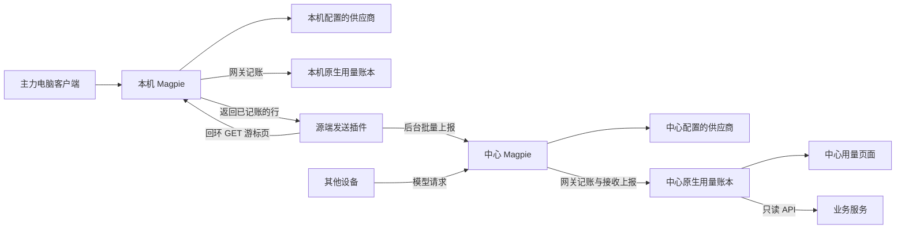

# Magpie Usage Hub

Magpie Usage Hub 将多台设备的模型调用用量汇总到一个中心 Magpie 实例。主力电脑继续使用本机 Magpie 和已配置的供应商，其他设备可直接调用中心。用户通过中心的原生用量页面查看统计，业务服务通过原生 API 查询。

**项目状态** · 第一阶段已通过双端验收。Windows Magpie `v0.1.4795` 可触发单页用量同步，Docker Magpie `v0.1.4572` 已核对上报、直接记账和只读权限。[第一阶段操作步骤](docs/07-部署接入与运行维护.md#第一阶段单条用量对账) · [验收记录](docs/08-开发阶段与验收计划.md)

## 技术栈

- **后台同步**由 Magpie 管理的 Bun 宿主运行，后端采用严格模式 TypeScript。
- **状态页**设计使用原生 HTML、CSS、JavaScript 和 Magpie 官方页面桥，沿用宿主主题。Web 通过服务页提供完整诊断，桌面通过普通 Options 配置插件。两种形态的实际交互分别验收。

## 数据流

源端插件由 Magpie 的 Bun 宿主运行，通过 Options 显式触发一次同步。插件读取一页本机已记账的网关调用，逐条确认中心回执后返回下一游标。游标持久化、故障重放和自动调度属于第二阶段，重放时由中心按稳定的记录 ID 去重。[同步流程与故障恢复设计](docs/05-同步流程与故障恢复设计.md)

## 查询口径与接口

中心账本同时包含直接经中心处理的调用（`through`）和由插件追加的记录（`reported`）。上报用于历史统计，中心的实时配额、预算和限流仍按自身的实时调用规则执行。`period=all` 查询当前账本可见的历史，结果取决于账本的保留范围。

| 场景 | 调用 |
| --- | --- |
| 源端增量读取 | `GET /v1/magpie/usage/requests?cursor=start&via=through`。首次可用 `cursor=now` 从当前进度开始，后续使用返回的 `next_cursor`。 |
| 中心接收上报 | `POST /v1/magpie/usage/requests`，使用源端专用的上报 Key。 |
| 业务读取汇总 | `GET /v1/magpie/usage?period=all`，使用独立的只读网关 Key。 |
| 业务读取上报明细 | `GET /v1/magpie/usage/requests?period=all&via=reported`，使用同一只读网关 Key。 |

接口参数和返回格式见 [Magpie v0.1.4783 原生 API 参考](https://github.com/yetone/magpie/blob/v0.1.4783/docs/reference.md)。

## 从这里开始

| 任务 | 文档 |
| --- | --- |
| 了解首版功能或开始开发 | [功能规格与文档索引](docs/01-插件定位与功能规格.md) · [整体架构与模块职责](docs/03-整体架构与模块职责.md) |
| 编写发送端、处理回执或重放 | [网关接口与用量数据规范](docs/04-网关接口与用量数据规范.md) · [同步流程与故障恢复设计](docs/05-同步流程与故障恢复设计.md) |
| 配置来源、接入中心或查询业务数据 | [配置与诊断页面设计](docs/06-配置与诊断页面设计.md) · [部署接入与运行维护](docs/07-部署接入与运行维护.md) |
| 在 Windows 搭建隔离开发环境 | [Magpie 插件开发指南](docs/Magpie插件开发指南.md) · 本地目录加载、页面与 Bun 后端示例、调试和分发 |
| 在仓库中开发、测试或同步更新文档 | [AGENTS.md](AGENTS.md) · 项目边界和开发 Skill 入口 |
| 准备首次在 GitHub 公开 | [GitHub 首次开源准备](docs/GitHub开源准备.md) · 公开范围、许可、历史审查和远端确认 |
