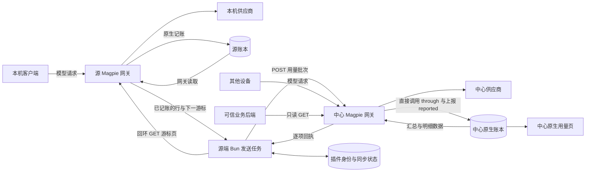

# 整体架构与模块职责

源端有两条独立链路。模型调用由本机 Magpie 转给本机配置的供应商并记账。发送插件随后通过回环网关获取已记账的行，经另一条连接向中心上报。中心不可达只会延迟同步。中心直接处理的设备请求仍走它自己的模型调用链路。

## 实现分工

下表按职责组织实现和评审，模块名及目录可随实际代码确定。一次修改从实际受影响的调用方开始追踪。

| 职责 | 输入与输出 | 拥有的决定 |
| --- | --- | --- |
| Bun 宿主入口 | 收到 `server(input, options)`，定位状态目录，初始化及结束任务。 | 安装项是否启用、何时中止旧任务并交接唯一运行权。 |
| 配置解析 | 把外部 Options 映射为类型明确的源、目标、凭据位置和调度参数。 | 拒绝不合法配置。已有进度时核对来源指纹、中心目标与历史边界。 |
| 后台调度 | 用已确认游标取页，调用映射和中心客户端，汇总整页结果。 | 唯一决定何时提交下一游标。安排轮询、退避、中止及每轮预算。 |
| 源端客户端 | 在本机回环网关 GET 一页，返回已校验的行、删除事件、后继游标和分页标记。 | 校验响应结构、保持查询身份与筛选一致，把源端游标错误交给调度处理。 |
| 行筛选与字段映射 | 输入一条已校验的源行、来源身份与已确认的范围。输出排除理由或合规上报行。 | 用纯函数判断采集资格、保留已知零值、构造稳定 `rid`。不合法的应采行会阻塞该页。 |
| 中心客户端 | 构造有大小限制的 HTTP 批次，解码并逐项匹配 `index`、`rid` 和状态。 | 只返回本批确认或受控失败。一个批次成功后仍需由调度器判断整页完成情况。 |
| 状态存储 | 管理身份、状态版本、互斥锁和原子文件替换。 | 持有锁的任务才能写入已确认进度，恢复过程保留最后可用的持久状态。 |
| 配置与诊断页 | 通过桥读取或保存 Options，按运行形态展示脱敏状态。 | 表达配置与运行结果、接收管理员的操作意图。后台在页面关闭后仍由宿主管理。 |

## 数据的归属

- 两端 Magpie 各自拥有原生账本。发送插件仅通过公开网关处理用量，逐请求明细由原生账本保管。中心沿用原生查询和展示能力。
- 来源身份、游标和锁位于 `input.directory` 下的插件专用状态目录。身份随原实例迁移，包升级时从包内读取的页面和脚本可以整体替换。
- 宿主从受保护的文件读取上报 Key。页面只接收供当前管理用户查看的脱敏字段。模型请求和响应正文留在模型调用链路，查询 Key 只交给可信业务后端。

开发单个字段时查[字段映射](04-网关接口与用量数据规范.md)。修改确认、互斥或重试时查[同步时序与恢复](05-同步流程与故障恢复设计.md)。修改页面与宿主之间的数据交换时查[配置与诊断页面设计](06-配置与诊断页面设计.md)。
