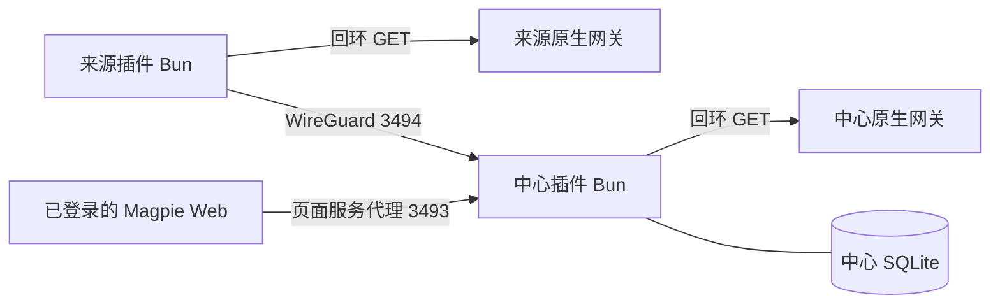

# 整体架构与模块职责

来源 Bun 从同宿主回环网关读取原生变化，沿受限 WireGuard 路径向中心提交。中心 Bun 把明细变更和检查点一起提交到 SQLite。中心本机采集沿用同一套同步流程并直接操作本地账本。已登录的 Magpie Web 通过回环页面服务查询已提交的活动数据集。

## 实现分工

| 职责 | 模块 | 边界 |
| --- | --- | --- |
| 宿主入口 | `server.ts`、`src/options.ts`、`src/host.ts` | 读取角色和修订，核对回环网关归属并取得插件状态锁。 |
| 采集与提交 | `src/sync/`、`src/gateway/` | 读原生变化页并投影白名单字段。来源复核中心身份并通过上报接口提交，中心本机调用相同账本操作。 |
| 接收与持久化 | `src/center/runtime.ts`、`src/center/ingest.ts`、`src/center/ledger.ts` | 启动接收入口，鉴权和限流，按来源事务提交明细、撤销、状态和游标。重建完成时切换活动数据集。 |
| 查询与管理 | `src/center/dashboard.ts`、`src/center/time.ts`、`src/center/sources.ts`、`src/diagnostics.ts` | 提供统计、明细及来源管理。页面服务分别校验查询和管理令牌，读取脱敏字段。 |
| 页面 | `page/`、`ui/` | 保存角色配置，展示后台诊断、时间筛选、趋势、明细和来源操作。 |

## 数据的归属

- Magpie 保存 Options 和本机原生用量。来源 Bun 在插件状态目录下的 `push/sender.json` 保存身份绑定，上报令牌保存在单独受保护的文件中。[配置字段](06-配置与诊断页面设计.md)
- 中心 Bun 将来源登记、令牌摘要、同步状态、检查点和用量明细保存在 `push/center.sqlite`。每个来源按活动数据集查询，以源端原调用时间筛选。[接口与统计口径](04-网关接口与用量数据规范.md)
- 运行锁将每个实例的状态写入交给单一宿主。暂停、断线和重建前保留的活动数据继续提供查询。[同步与故障恢复](05-同步流程与故障恢复设计.md)
