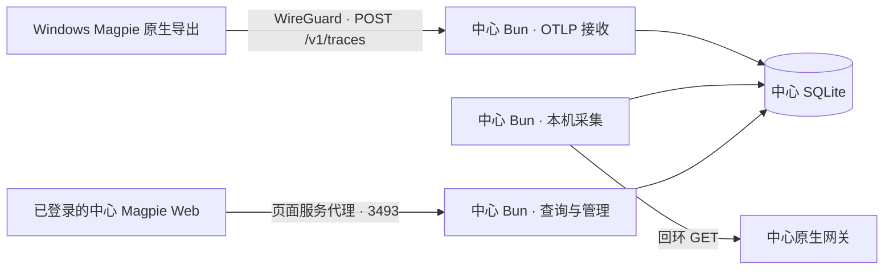

# 整体架构与模块职责

Usage Hub 运行在中心 Magpie 管理的 Bun 宿主内。Windows Magpie 原生导出器经 WireGuard 发送 OTLP Trace，中心按令牌匹配来源并提交用量。中心本机采集从自己的回环网关读取变更，将明细和游标在同一事务提交。已登录的中心 Magpie Web 通过回环页面服务查询已发布的用量和管理来源。

## 实现分工

| 职责 | 模块 | 边界 |
| --- | --- | --- |
| 宿主入口 | `server.ts`、`src/options.ts`、`src/host.ts`、`src/center/runtime.ts` | 读取中心 Options 和修订，确认回环网关归属并取得状态锁，启动本机采集和查询。启用接收时单独绑定 OTLP，绑定失败仍可查已发布账本。 |
| OTLP 接收 | `src/center/ingest.ts`、`src/center/otlp.ts` | 检查路由、鉴权和限额，选取 Magpie 的网关尝试与会话生成，映射用量白名单。在提交时复核来源及凭据。 |
| 中心本机采集 | `src/sync/`、`src/gateway/` | 从已提交的本机游标读原生变更页，映射用量、撤销，提交明细与下一游标。 |
| 持久化 | `src/center/ledger.ts` | 在 SQLite 保存来源、凭据摘要和已发布的用量。OTLP 以首次接收快照入账。本机回填或重建追到末页时发布活动数据集。 |
| 查询与管理 | `src/center/dashboard.ts`、`src/center/time.ts`、`src/center/sources.ts`、`src/diagnostics.ts` | 页面服务分别校验查询与管理令牌，返回统计、脱敏明细和来源状态。 |
| 页面 | `page/`、`ui/` | 静态入口进入本实例页面服务根路径。服务页展示概览和明细，配置页负责 Options、来源操作和后台诊断。 |

## 数据的归属

- Windows Magpie 持有导出设置和上报令牌。中心 Magpie 保存插件 Options 和本机原生用量。[配置与诊断](06-配置与诊断页面设计.md)
- 中心插件在专用状态目录的 `push/center.sqlite` 保存来源、凭据摘要、本机检查点和用量。账本区分中心本机 `local`、已迁移的历史来源 `legacy` 和新登记的 `otlp`。中心以原事件时间筛选各来源已发布的数据。[接口与统计口径](04-网关接口与用量数据规范.md)
- 运行锁把状态写入交给持锁宿主。接收服务记录 OTLP 用量时，同时更新最近接收时间和待用凭据验证状态。本机重建期间，查询仍使用上一次发布的本机数据集。[同步与故障恢复](05-同步流程与故障恢复设计.md)
