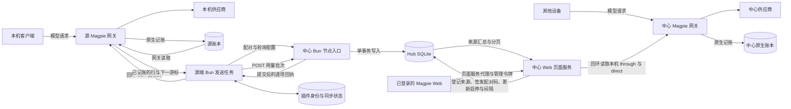

# 整体架构与模块职责

源端有两条独立链路。模型调用由本机 Magpie 转给本机配置的供应商并记账。发送插件随后通过回环网关获取已记账的行，经另一条连接向中心上报。中心不可达只会延迟同步。中心直接处理的设备请求仍走它自己的模型调用链路。

## 实现分工

下表按职责组织实现和评审，模块名及目录可随实际代码确定。一次修改从实际受影响的调用方开始追踪。

| 职责 | 输入与输出 | 拥有的决定 |
| --- | --- | --- |
| Bun 宿主入口 | 收到 `server(input, options)`，校验 Options 后启动后台任务并返回。 | 安装项是否启用。旧宿主退出时释放运行权。 |
| 配置解析 | 将 Options 解析为角色、回环网关、节点入口和凭据位置。托管来源的采集条件与间隔来自中心配置。 | 校验本地配置和中心响应后再交给持锁任务。 |
| 后台调度 | 托管节点先配对及读取配置。启用时用已确认游标取页、调用映射和上报客户端，汇总整页结果。 | 决定何时提交下一游标，安排轮询、退避、中止及每轮预算。 |
| 源端客户端 | 在本机回环网关 GET 一页，返回已校验的行、删除事件、后继游标和分页标记。 | 校验响应结构、保持查询身份与筛选一致，把源端游标错误交给调度处理。 |
| 行筛选与字段映射 | 输入一条已校验的源行、来源身份与已确认的范围。输出排除理由或合规上报行。 | 用纯函数判断采集资格、保留已知零值、构造稳定 `rid`。不合法的应采行会阻塞该页。 |
| 中心客户端 | 构造有大小限制的 HTTP 批次，解码并逐项匹配 `index`、`rid` 和状态。 | 只返回本批确认或受控失败。一个批次成功后仍需由调度器判断整页完成情况。 |
| 中心节点入口 | 中心宿主取得运行锁后监听配对、配置和上报入口。对节点凭据绑定来源，校验启停、UUID、供应商和批次字段。 | 一次性兑换配对码，返回专属配置，事务写入 Hub SQLite。按 `rid` 保留首条记录，提交成功后给出逐项回执。 |
| 看板服务 | 从回环原生网关读取 `computer=this`，从 Hub SQLite 读取来源统计与分页。 | 对齐中心日期口径并独立报告两类账本状态；两者都可用才给合计。 |
| 来源管理服务 | 经回环 Magpie Web 页面服务核对管理令牌，登记来源及更新启停和间隔。 | 每个来源固定一个 UUID 和采集范围。中心保存最近联系与接收新记录的时间。 |
| 状态存储 | 管理身份、状态版本、互斥锁和原子文件替换。 | 持锁后核对来源、筛选条件、中心目标和首次模式，写入已确认进度。 |
| 配置与诊断页 | 通过桥读取或保存 Options，按运行形态展示脱敏状态。 | 表达配置与运行结果、接收管理员的操作意图。后台在页面关闭后仍由宿主管理。 |

## 数据的归属

- 两端 Magpie 各自拥有原生账本。发送插件通过公开回环网关采集用量。旧来源经原生接收记入 `reported`；试用经 Hub 接收记入独立 SQLite。
- 节点凭据、来源身份、游标和锁位于 `input.directory` 下的插件专用状态目录。中心账本位于 `center/`，同时保存托管来源、凭据摘要及状态时间。包内页面和脚本可以随包整体替换。
- 配对码通过受保护的文件交接，节点持久保存自己生成的凭据。旧版连续同步从受保护的文件读取上报 Key。看板和诊断展示管理所需的运行数据，模型请求与响应正文留在模型调用链路。[配对、配置与上报](04-网关接口与用量数据规范.md#节点入口与配对)

开发单个字段时查[字段映射](04-网关接口与用量数据规范.md)。修改确认、互斥或重试时查[同步时序与恢复](05-同步流程与故障恢复设计.md)。修改页面与宿主之间的数据交换时查[配置与诊断页面设计](06-配置与诊断页面设计.md)。
