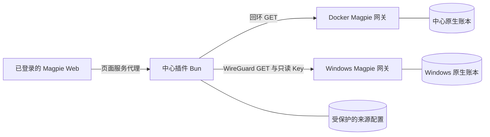

# 整体架构与模块职责

中心 Bun 通过 Magpie Web 的页面服务代理接收查询，向各实例的原生网关读取所选周期内的本机汇总。中心本机走容器内回环，Windows 等来源走受限 WireGuard 路径。各实例在模型请求链路上自行记账。

## 实现分工

| 职责 | 模块 | 边界 |
| --- | --- | --- |
| 入口和所有权 | `server.ts`、`src/options.ts`、`src/center/runtime.ts` | 解析 Options，确认回环网关归属。中心宿主持有运行锁后加载来源配置，并提供页面服务。 |
| 配置与凭据 | `src/center/sources.ts` | 保存稳定来源 ID、名称、网关根地址、Key 和启停。串行检查修订并原子写入，持久化后发布新配置。 |
| 原生查询 | `src/center/dashboard.ts`、`src/gateway/direct.ts` | 按已登记的来源构造固定 GET 请求，控制直连、超时与响应大小，校验原生分项并生成脱敏结果。 |
| 代理 API | `src/diagnostics.ts` | 从回环端口提供页面、资源和受控状态。来源管理校验令牌，浏览器响应使用字段白名单。 |
| 页面呈现 | `page/`、`ui/dashboard/`、`ui/sources/` | Options 页保存启动设置并提供 Web 入口，看板按周期查询，来源页登记地址与轮换 Key。 |

## 数据的归属

- 普通 Options 由 Magpie 保存，来源配置及凭据由中心 Bun 写入插件专用目录的 `pull/sources.json`。目录和文件仅供宿主账号及必要管理员访问，受保护的配置备份与包文件分开管理。[配置字段](06-配置与诊断页面设计.md)
- 原生账本由各自的 Magpie 持有。中心读取 `computer=this` 的 `through` 与 `direct` 汇总。同一轮查询最多有 4 个来源并发，页面按来源呈现成功或失败。[接口与统计口径](04-网关接口与用量数据规范.md)
- 看板结果随所选周期按需读取。停用、断链或关页后的行为见[故障恢复](05-同步流程与故障恢复设计.md)。`0.4.0` 账本位置和接入方式用于[升级与回退](07-部署接入与运行维护.md#升级与回退)。
