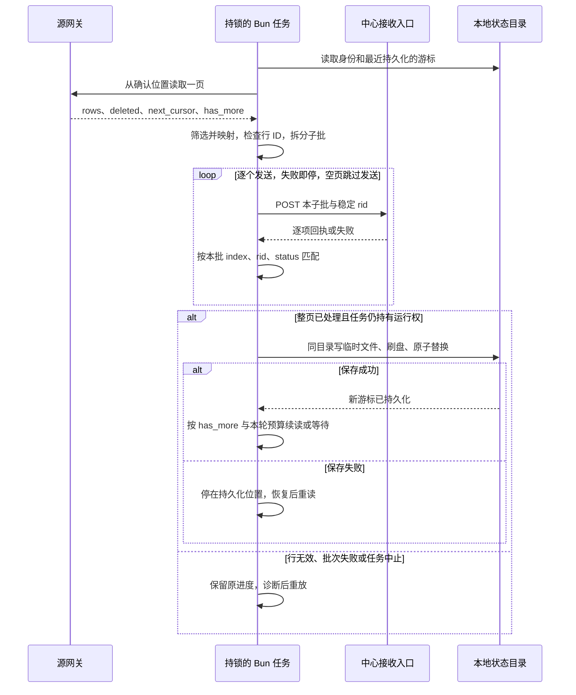

# 同步流程与故障恢复设计

**进度的提交单位是一页。** 一页中所有应发送的行都拿到匹配回执，且本地新状态持久化成功，才算确认该页。中心收到部分数据后，本地仍可安全重读原页，因为相同来源和源行始终生成相同 `rid`。[字段与回执规范](04-网关接口与用量数据规范.md)

## 来源身份与任务所有权

| 状态 | 保存内容与约束 |
| --- | --- |
| `identity.json` | 版本 `1` 与随机 UUID `sourceInstanceId`，该 UUID 用作 `rid` 中的 `sourceId`。重载、升级、回填和原实例迁移沿用该身份。 |
| `state.json` | 保存来源 UUID、日常游标、确认时间，以及来源网关、专用 Key ID、中心目标、首次模式和试用供应商 ID（仅试用绑定）。首个回填请求受理前使用版本 `1`，可附回填拒绝记录。受理时原子升级到版本 `2`，随后持久化活动回填及其结果。 |
| `sync.lock.sqlite` | 在规范化的本地状态目录中使用 Bun 的 SQLite 写事务持有跨进程锁。启动或接管后，持锁任务读取进度、受理回填、发送及提交。停用宿主可以只读加载已落盘的状态供诊断。 |

`magpie-usage-hub/` 位于 Magpie 配置目录内。原生上报的身份和进度在该目录中，手工配置的 Hub 来源使用 `trial/`，托管来源使用 `managed/`。各模式共用根目录的运行锁。切换前先停用旧任务，备份对应 Options、身份和游标，供日后按原绑定恢复。

每个全新绑定依序原子保存空游标状态与同一 UUID 的身份文件，再读取源页。若仅缺身份文件，从已验证且绑定一致的状态重建。有身份却缺进度，或身份、版本、配置绑定不一致时，保留文件并阻塞。手工配置可在同一中心为同一身份轮换上报凭据。

后台任务通过来源回环网关 `GET /` 的 PID 核对 Bun 宿主归属。Options 重载时，新宿主等写锁释放或旧进程退出后再读状态。Magpie `v0.1.4799` 在旧宿主还有请求时最多等待十分钟才结束它，旧任务在此期间仍可能按旧 Options 轮询。锁文件保留在本地，运行权由 SQLite 写事务与进程生命周期管理。停用以旧任务退出为准。[Magpie 宿主交接](https://github.com/yetone/magpie/blob/v0.1.4799/internal/plugin/host.go#L848-L905)

## 托管配对、启停与续传

1. 持锁任务先在 `managed/registration.json` 原子保存节点生成的凭据及网关与中心绑定。该目录及备份仅供宿主账号和必要管理员访问。节点先尝试读取配置，尚未配对时再用配对码提交凭据摘要。中心成功提交却丢失应答时，节点重试配置读取仍使用同一凭据。配置可读后，节点保存中心分配的来源 UUID，并用它建立 `managed/identity.json` 和 `managed/state.json`。[节点入口与配对](04-网关接口与用量数据规范.md#节点入口与配对)
2. 每轮先读取中心配置。首次启用采集时读取源 `now` 空页，持久化其游标后诊断才显示就绪。暂停时继续按中心间隔读取配置，保持已持久化的进度。中心暂停后，在途批次若收到 `403 source_paused`，本地保留该页原游标，任务自动重试。恢复后从原游标读取，重复行用同一 `rid` 确认。
3. 启停和间隔在下一轮读取配置时采用。采集范围与游标绑定，变更时创建新来源，经新配对建立 `now` 游标。更换同一设备的来源时，先停用并归档整个 `managed/`，再配置新配对码。[来源运维](07-部署接入与运行维护.md#管理已配对的来源)

## 从首次启用到连续轮询

1. 托管来源首次启用从 `now` 起步，手工配置按 `initialMode` 取 `start` 或 `now`。已有确认游标时从该游标续读。`now` 的采集起点以首次成功落盘的空页游标为准。发起第一条试用调用前，另在中心确认来源及接收入口就绪。
2. 校验整页结构，按已确认的来源和历史范围筛选。设有供应商条件时，按专用 Key ID 与本机供应商 ID 的交集读取，逐行核对两项 ID。被排除的记录与 `deleted` 留在本机，无法映射或筛选不匹配的应采行会阻塞该页并提示原因。
3. 顺序发送该页的子批。一个子批超时、回执缺失、重复、错位或状态未知，就停止处理该页。远端已经接收但响应丢失时，重放相同 `rid`，按中心返回的 `skipped` 确认。
4. 整页确认后，在状态文件同一目录写临时文件、刷盘、原子替换。空页和只有合法排除项的页也提交 `next_cursor`。刷盘或替换失败时以最近持久化的游标恢复。进程中断场景需验证重放结果。如需承诺物理掉电恢复，还须核实目标文件系统对文件数据和目录项的持久化保证。
5. `has_more=true` 时，每轮最多处理 5 页，并在页间判断是否已用满 30 秒预算。结束本轮后等待正常轮询间隔，再从已保存位置继续。单页内的 HTTP 超时独立计算。

## Hub 上报持久化

中心角色取得本实例运行锁后，打开 `magpie-usage-hub/center/usage.sqlite`，再启用节点入口。已有 Hub 账本从 schema `1` 以事务升级到 `2`，保留已入账记录。配对码的消耗与凭据摘要的保存由同一事务完成，来源的启停、范围和联系时间也保存在此账本。

中心按绑定校验整个上报批次，启用的托管来源才可入账。`rid` 为主键，事务提交后才返回逐项回执，同一 `rid` 的重放保留首条记录并返回 `skipped`。中心事务提交而本地游标未落盘时，从上一确认页重放。账本采用 WAL 与 `synchronous=FULL`，备份使用停写后的文件集或一致的 SQLite 备份。[中心接收与备份](07-部署接入与运行维护.md#启用中心接收)

## 向原中心回填

手工配置的连续同步通过 Options 的 `recoveryRequest` 提交已确认的回填请求。请求含 UUID v4、回填方式、时间边界及与日常进度相同的完整绑定。Bun 宿主采用设置、取得现有锁并核对绑定后受理。必须已有日常确认游标。同一请求 UUID 在活动任务或持久结果中出现时沿用已有记录。回填占用同一轮询任务，期间优先推进回填游标，完成后继续日常同步。[提交与受理状态](06-配置与诊断页面设计.md#提交与跟踪回填)

| 方式 | 读取与发送范围 | 整页确认后 | 扫描完成后 |
| --- | --- | --- | --- |
| 补齐指定时间段（`range`） | 从 `cursor=start` 扫描原来源当前可读的 `via=through` 请求流。按原调用时间发送 `[from, to)` 内符合原绑定筛选条件的行。 | 保存独立回填游标、确认时间和计数。 | 源返回 `has_more=false` 时写入完成结果。日常游标和日常确认时间沿用回填前的值。 |
| 恢复失效游标（`cursor`） | 用原绑定实际读取日常游标。源网关返回 `410 cursor_reset` 或 `410 cursor_expired` 后，从 `cursor=start` 扫描，发送 `from` 起可读且符合条件的行，直至源流当前进度。 | 保存独立回填游标、确认时间和计数，日常游标继续指向原位置。 | 最后一页的回执确认后，将完成结果、日常 `cursor` 和 `lastConfirmedAt` 一次原子提交。随后从新的日常游标续读。 |

两种方式均按源流分页读取，时间边界用于筛选上报行。由原 `sourceInstanceId` 与源行 ID 生成相同的 `rid`。中心返回的 `accepted` 与 `skipped` 都确认对应的行，结果分别累计接收和去重计数。中心已接收但状态尚未落盘时，从上一确认页重读，用相同 `rid` 继续核对回执。

回填只有一项活动任务。不同 UUID 的新请求在已有活动任务时记为 `recovery_busy`。请求绑定不匹配或缺少确认游标时提示对应原因。游标有效时，游标恢复请求记为 `recovery_cursor_valid`。源返回 `cursor_invalid` 或 `cursor_filter_changed` 时，记为 `recovery_cursor_incompatible`，先核对来源与筛选配置。已有状态可写时，请求的拒绝结果随状态保存。

需要暂停时保存停用设置，等旧宿主退出。再次启用原配置后，任务从持久化的活动回填游标继续。清除 Options 中的待受理请求只影响后续宿主读取该请求，已落盘的活动回填仍可按原状态恢复。如果活动回填游标收到源网关的 `410 cursor_reset` 或 `410 cursor_expired`，任务持久化失败原因、已确认页数和计数，保留原日常游标。再次回填前核对可读历史，从配置页重新确认范围并提交新请求。

## 故障处理与恢复点

| 触发条件 | 处理与允许恢复的条件 |
| --- | --- |
| 网络中断、超时、`429`、`5xx` | 保留已确认游标。从 10 秒起带抖动指数退避，本地等待最长 15 分钟。有效的 `Retry-After` 更长时采用服务给出的等待。整页再次确认后恢复正常轮询。 |
| 托管上报 `403 source_paused` | 保留已确认游标，等待下一轮读取中心配置。启用后沿用原身份和游标续传。 |
| 配对码过期、丢失或已使用 | 先用已保存的凭据检查配置能否读取。尚未配对的来源可在中心重新生成配对码，更新受保护的文件后重试。 |
| 其他中心 `401`、`403`、`404`、`405` | 核对节点入口、凭据及来源绑定，按诊断修复。保留原进度并从原位置续读。 |
| 中心 `400` 或 `413` | `400` 用脱敏标识、已知字段名定位映射或时钟问题。修复后重放整页。`413` 核对入口限制、缩小子批。单行仍超限时阻塞处理。 |
| 日常读取收到源 `410 cursor_reset`、`410 cursor_expired` | 阻塞并保留日常进度。手工配置可核对绑定和可读历史后提交游标恢复。托管来源先确认缺口和备份，再决定恢复原网关或以新来源建立新起点。 |
| 回填读取收到源 `410 cursor_reset`、`410 cursor_expired` | 记录 `recovery_scan_cursor_reset` 或 `recovery_scan_cursor_expired` 及已确认计数，结束该回填。日常游标仍可作为续读或再次恢复的依据。 |
| 源 `400 cursor_invalid`、`400 cursor_filter_changed` | 阻塞并保留进度。检查源实例、筛选条件及读取身份。 |
| 本地状态不可读、刷盘或替换失败 | 阻塞并保留最近可读的状态。修复存储问题后重载，从持久游标重放。 |
| 进程崩溃、重载、电脑休眠或关机 | 重新取得运行权，从持久游标续读。若崩溃发生在中心确认之后、落盘之前，重放整页并核对中心每个 `rid` 仅一条。 |
| 原中心恢复旧备份 | 暂停推进并确认缺口。恢复原配置后按原身份补齐指定时间段，由中心按 `rid` 去重。旧日常游标可能领先于中心备份。 |
| 中心地址或来源筛选变化 | 暂停推进，备份原状态并确认新绑定和历史边界。新绑定接入走单独的迁移流程。[备份、恢复和升级](07-部署接入与运行维护.md#备份恢复和升级) |
| 源端返回 `deleted` 或同一源行发生修正 | 两种中心账本均按 `rid` 追加去重，历史上报不会随源端删除或同 ID 修订而更新。原生旧上报订正须按[离线清理与回退](07-部署接入与运行维护.md#旧版原生上报的离线清理与回退)另行审批。 |

源端已清理的记录需从可用备份恢复。`has_more` 和距最近确认的时长可反映积压迹象，二者均不能直接换算为剩余行数。[请求流的读取成本与过期规则](https://github.com/yetone/magpie/blob/v0.1.4783/docs/subsystems/gateway-sessions.md#the-request-feed)
