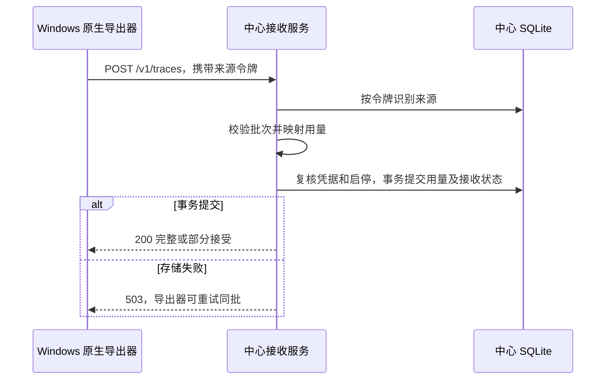

# 同步流程与故障恢复设计

Windows 原生 OTLP 在进程内缓冲并发送新增观测，中心按批次提交用量。中心本机则从 SQLite 已提交的游标续读回环网关的原生变更。两条链路各自维护进度与恢复边界。[原生网关与接收契约](04-网关接口与用量数据规范.md)

## 确认与续传

### Windows OTLP

Magpie `v0.1.4799` 的元数据导出队列最多容纳 128 条，每批最多 32 条。首条进入空批后约 5 秒刷新，满批提前发送。网络错误及 HTTP `429`、`502`、`503`、`504` 可重试，总共最多 3 次发送。收到 `200` 的部分接受时，导出器记录提示并结束该批；受理的用量已经提交。[原生队列与批量](https://github.com/yetone/magpie/blob/v0.1.4799/internal/otlp/otel.go#L24-L26) · [刷新与重试](https://github.com/yetone/magpie/blob/v0.1.4799/internal/otlp/otel.go#L197-L269) · [HTTP 处理](https://github.com/yetone/magpie/blob/v0.1.4799/internal/otlp/otel.go#L327-L383)

中心以来源 ID 和 Trace、Span 标识的摘要保留第一次接受的快照。回执丢失后重发同批不会增加明细条数，迟到的用量仍计入原调用时段。有效用量批次（含重复观测）同时更新最近接收与待用凭据验证；只有非用量 span 的批次保留原状态。暂停、撤销与在途提交冲突时，以提交事务内复核的状态为准。[接收契约](04-网关接口与用量数据规范.md#中心接收接口)

启用导出后从新记录的事件开始。队列溢出、重试耗尽、进程中止或导出配置变化均可能丢失尚未送达的事件。Windows 恢复运行后继续发送新事件，过往未送达的用量没有持久队列可供重放。[原生批次配置校验](https://github.com/yetone/magpie/blob/v0.1.4799/internal/otlp/otel.go#L273-L311) · [原生会话导出起点](https://github.com/yetone/magpie/blob/v0.1.4799/internal/otlp/otel_sessions.go#L113-L148)

### 中心本机游标

中心从已提交游标读取下一页，事务内应用明细更新、撤销及下一游标。空页也更新检查点。无积压时约 60 秒检查一次；有积压时每轮最多读 5 页，处理完当前请求后检查约 30 秒的轮次预算，再短暂等待后继续。超时、限流或暂时不可用触发约 10 秒至 5 分钟的退避，含随机抖动。检查点修订发生冲突时，从 SQLite 最新的已提交位置重读。[中心本机网关](04-网关接口与用量数据规范.md#原生网关查询)

## 来源配置与宿主交接

中心保存 Options 后，在持有回环网关的 Magpie Web 打开后台诊断，确认新 Bun 已取得运行锁并采用保存修订。Windows 保存原生导出设置后，以中心「最近接收」和新调用明细确认生效。轮换时先登记新摘要，使用新令牌成功提交有效用量，再撤销旧令牌。[配置采用与诊断](06-配置与诊断页面设计.md) · [部署接入](07-部署接入与运行维护.md)

## 故障处理

| 现象 | 持久状态与恢复动作 |
| --- | --- |
| Windows 断线、休眠或来源暂停 | 已提交的用量继续可查。恢复网络并启用来源后生成新用量，核对下一次「最近接收」。按时间与 Windows 原生记录核对可能丢失的范围。 |
| `401 report_key_invalid`、`403 source_paused` | 核对原生设置的认证头、中心登记摘要和启停。修复后用新事件确认接收。 |
| 中心本机 `cursor_expired` | 自动建立待发布数据集，从 `start` 扫描可见原生历史。追到末页后事务切换。已有版本在重建期间可查，完成后记录旧版本中本轮未见的明细数和区间。 |
| 中心本机 `cursor_reset`、`cursor_filter_changed`、`cursor_invalid` | 保留游标和活动数据集。管理员核对本机网关、实例归属与查询范围，在来源管理确认重建，再从 `start` 扫描。 |
| 状态目录或 SQLite 写入失败 | 保留旧提交和本机检查点。接收服务可返回 `503`，启动失败时见后台诊断。核对宿主权限、持久卷和磁盘空间，修复后核对中心修订和新用量。 |
| 管理修订冲突 | 读回最新来源列表，核对期间变化再提交。 |

中心本机重建的范围由当时可读的原生账本和会话历史决定。Magpie `v0.1.4799` 原生删除记录保留 30 天。恢复前已消失的明细需从历史备份核对。[游标失效和删除记录保留](https://github.com/yetone/magpie/blob/v0.1.4799/internal/usage/feed.go#L236-L253) · [原生裁剪](https://github.com/yetone/magpie/blob/v0.1.4799/internal/usage/feed.go#L395-L412)

## 账本迁移与备份恢复

`push/center.sqlite` schema 2 保留 schema 1 已发布的明细和来源 ID。旧远端来源以 `legacy` 查历史，中心本机以 `local` 保留已提交游标。Windows 切换到原生导出时登记新的 `otlp` 来源和令牌，已发布历史仍按旧来源查询。回退旧版时恢复升级前的状态快照。[升级与回退](07-部署接入与运行维护.md#升级与回退)

从备份恢复时先停止接收和写入，恢复同一时点的状态。中心启动时重发管理修订与来源检查点修订，保留中心身份、来源 ID 及本机游标。开放接收前核对备份时间之后的凭据轮换和撤销。本机从恢复的游标续读，失效时走对应重建流程。OTLP 明细恢复至备份时点，之后已过导出器重试窗口的事件可能形成缺段。[备份与运维](07-部署接入与运行维护.md#日常维护)
