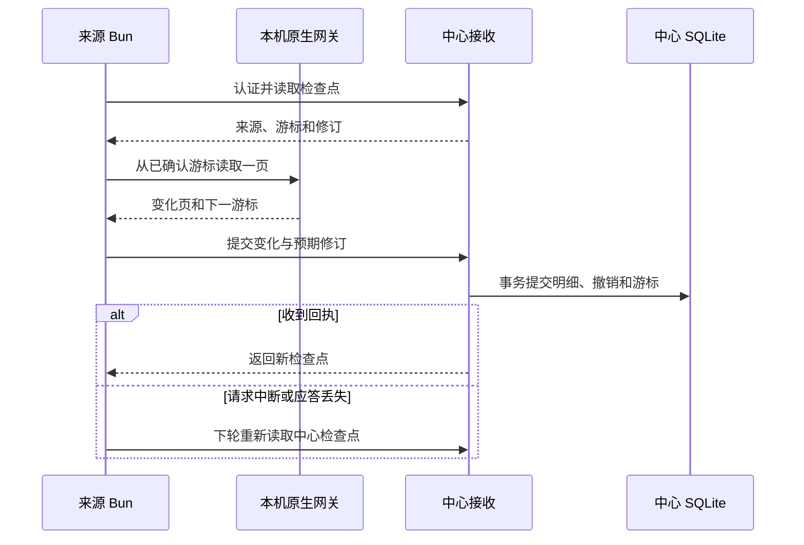

# 同步流程与故障恢复设计

来源回环网关提供可重读的原生变化。中心 SQLite 已提交的游标决定下次续读位置，来源插件只持久化身份绑定。每一轮从中心读回检查点。中心状态和历史明细以同一事务提交。[原生网关与上报契约](04-网关接口与用量数据规范.md)

## 确认与续传

空页也确认，更新同步状态。没有积压时约 60 秒再检查。有积压时每轮最多读 5 页，并在达到约 30 秒后结束本轮。一次仍在途的网络请求受单次请求超时控制。超时、限流或暂时不可用触发约 10 秒至 5 分钟的退避，含随机抖动。冲突时重新读取检查点。旧修订的重复或迟到提交会得到冲突响应，已提交的明细保持有效。

## 来源配置与宿主交接

配置保存后，从持有该网关的 Magpie Web 打开后台诊断，确认后继 Bun 取得运行锁并采用最新修订。采集前校验回环网关属于这一 Magpie 进程。来源绑定保存中心实例 ID、来源 ID、中心地址、回环地址和本机状态目录。保持绑定和令牌，重新启用或修复网络后可继续同一来源的同步。搬迁时先停旧任务，再由管理员核对来源身份与目标。新设备使用新来源 ID。[配置采用与诊断](06-配置与诊断页面设计.md) · [来源迁移步骤](07-部署接入与运行维护.md#日常维护)

## 故障处理

| 现象 | 持久状态与恢复动作 |
| --- | --- |
| 来源断线、休眠或暂停 | 中心继续显示最后确认的活动数据。Magpie 和网络恢复运行且来源启用后，从中心检查点续传可读变更。 |
| 上报凭据失效或来源不符 | 中心保留原检查点。核对令牌文件、已登记摘要和来源 ID，等待下一次认证或重载来源配置。 |
| `cursor_expired` | 自动建立新的待发布数据集，从 `start` 扫描可见原生历史。追到末页后事务切换；已有版本在重建中可查。完成后记录旧版本中本轮未见行数和可能受影响的区间。 |
| `cursor_reset`、`cursor_filter_changed`、`cursor_invalid` | 保留检查点及活动数据集。管理员从中心核对网关、源实例归属和查询范围，确认同源后执行重建。新来源另行登记。 |
| 中心恢复旧备份 | 停写后恢复同一时点的库和状态。中心在启动事务中更换所有来源检查点修订和管理修订，保留各端身份及检查点游标。来源从恢复的检查点继续读取。游标已失效时走对应重建流程。核对备份后新增、当前原生已不可读的记录，并记录恢复缺口。 |
| 状态目录或 SQLite 写入失败 | 保留旧提交。核对宿主权限、持久卷和磁盘空间，修复后重载并核对检查点。 |
| 管理修订冲突 | 读回最新来源列表，核对期间变化再提交。 |

中心持有原生可见明细的副本。原生撤销会更新所属来源的活动数据，重建按当时可见数据发布。首次回填或恢复前已消失的明细需从历史备份核对。原生删除记录保留期在核对版本为 30 天，具体可回放范围还受原生账本和本机会话历史影响。[原生失效和删除记录保留](https://github.com/yetone/magpie/blob/v0.1.4799/internal/usage/feed.go#L236-L253) · [原生裁剪处理](https://github.com/yetone/magpie/blob/v0.1.4799/internal/usage/feed.go#L395-L412) · [备份与运维](07-部署接入与运行维护.md#日常维护)
