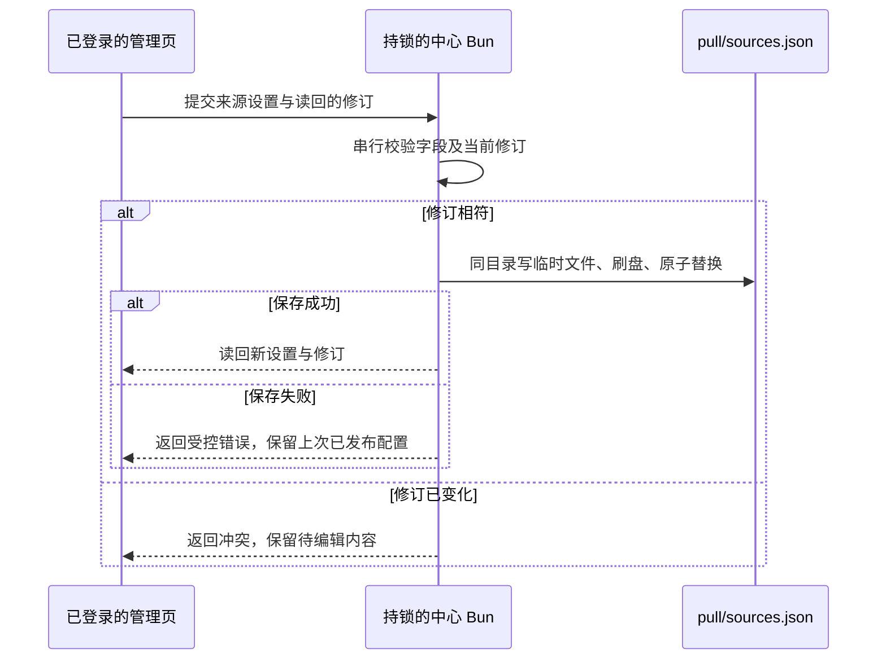

# 同步流程与故障恢复设计

中心在页面打开、切换周期或刷新时读取各来源。读取成功后将本次汇总送给页面，历史可见范围取决于各自原生账本的保留设置。来源断线后恢复，再刷新即可重新查询所选周期内的现存记录。[原生网关与查询口径](04-网关接口与用量数据规范.md)

## 来源配置与宿主交接

中心宿主通过同实例的回环网关核对归属，并使用现有中心进程锁保证写入所有权。后继宿主取得锁后，从插件专用状态目录读回已持久化的来源设置。来源 ID 随配置持久保存，停用再启用或轮换 Key 时继续使用同一 ID。[配置与诊断](06-配置与诊断页面设计.md)

## 故障处理

| 现象 | 保留的状态与恢复动作 |
| --- | --- |
| 某来源超时、网络中断或网关不可用 | 本轮其他来源照常显示。恢复来源网络后刷新，用相同周期核对原生用量。 |
| 网关返回 `401` 或 `403` | 核对 Key 是否仍有效、来源网关对中心出站地址的放行和 Key 的范围。使用「测试连接」验证后再保存。 |
| 原生响应不兼容 | 核对网关地址、Magpie 版本和原生响应的周期与分项。结果显示该来源暂不可用。 |
| 快速切换周期或重复刷新 | 最新请求拥有页面展示权，迟到的响应不能覆盖当前结果。 |
| 并发编辑出现修订冲突 | 先重读来源列表并核对期间变化，再重新提交草稿。 |
| 配置不可读或无法持久化 | 核对宿主账号权限、挂载和磁盘状态。失败时保留已有文件及已发布配置。需要从备份恢复时，先停用中心并确认宿主退出。 |

原生上报、游标续传、回填与 Hub 账本的恢复按实际部署的旧版本执行。[`v0.4.0` 同步流程和故障恢复](https://github.com/xiao-xiao-cai/magpie-usage-hub/blob/v0.4.0/docs/05-同步流程与故障恢复设计.md) · [升级与回退](07-部署接入与运行维护.md#升级与回退)
