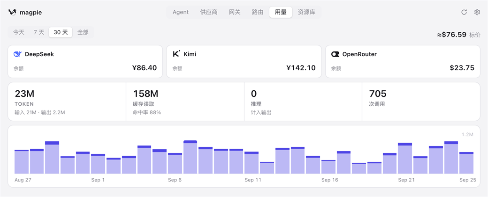
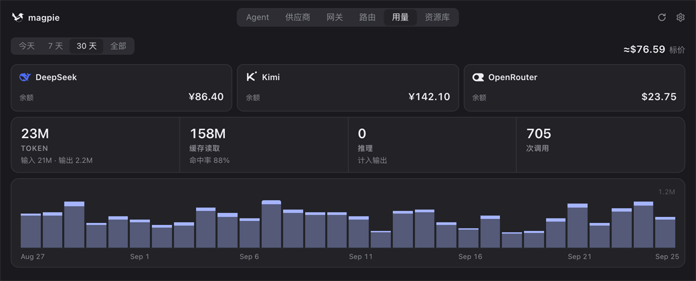
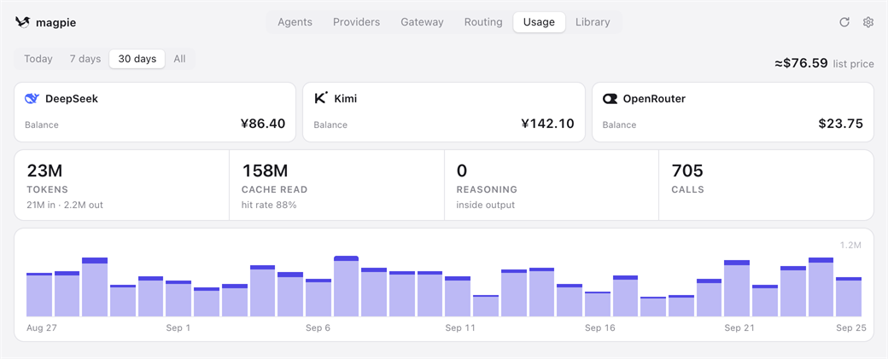
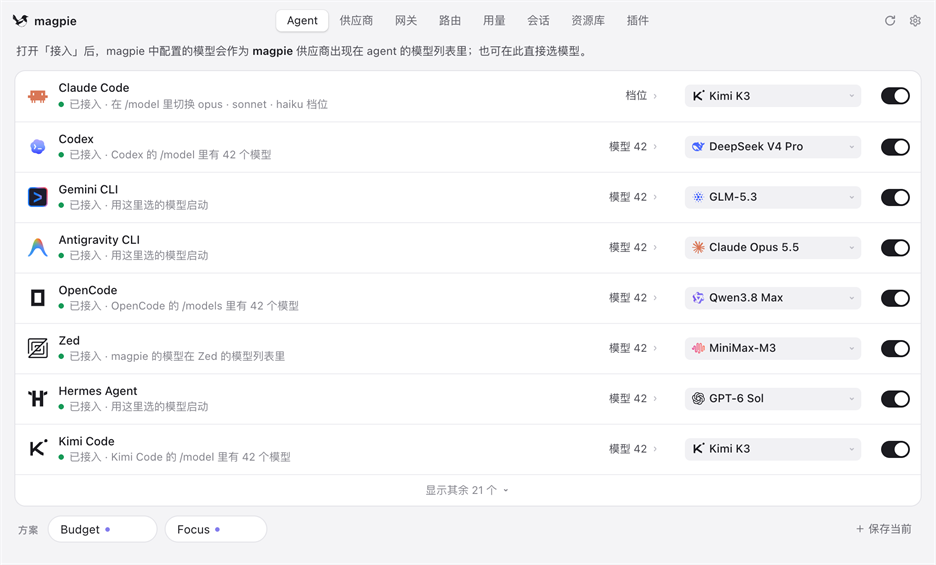
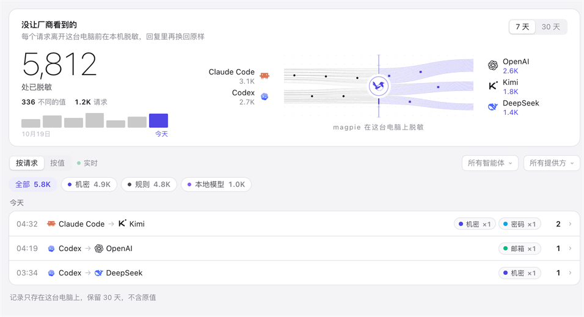
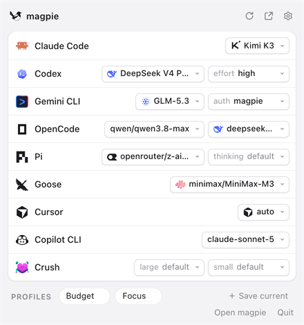
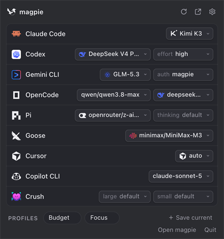
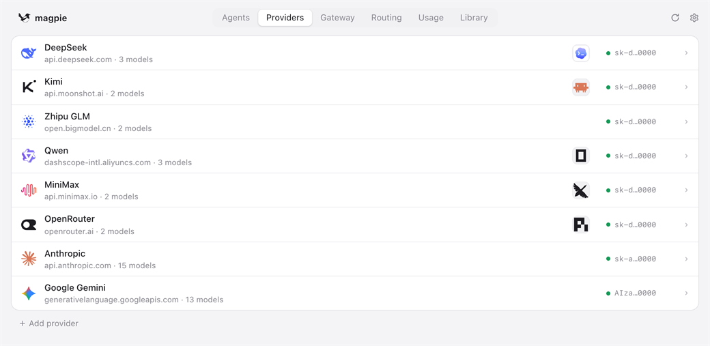

# Magpie 前端风格设计指南

面向「用原生 HTML/CSS/JS 复刻或扩展 Magpie 界面」的完整视觉规范。每条规则都给出**精确值**与**源码出处**（仓库相对路径 + 行号），供人和 AI 直接落地，不靠印象。

- 取证基线：`yetone/magpie` `main@33dc51a3d`（2026-11-28）。
- 取证范围：`internal/gui/assets`（应用 UI，权威）、`site/public`（官网与文档站，第二语言）、`docs/subsystems/gui-shell.md` 与 `docs/code-standards.md`（既有约定）。
- 适用对象：桌面窗口、菜单栏面板、浏览器版、插件页 iframe 四类上下文，以及官网/文档站。

## 0 怎么用这份文档

给 AI 的读法，按顺序三步，不要通读：

1. 先读 [§12 一致性检查清单](#12-一致性检查清单)，它是可执行的验收口径。
2. 按要做的组件查对应章节（卡片 → §4，数字 → §6，状态 → §8）。
3. 抄 [附录 B CSS 速查](magpie前端风格设计指南-附CSS速查.css) 的骨架，只改内容，不改骨架里的数值。附录里每条规则前的 `R2.3` 注释指回本文档的规则号。

三条元规则，优先于任何单条规则：

- **规则号 `R章.序`**：正文里出现的每个断言都可被引用与抽检。
- **三处门槛**：同一写法在源码出现 <3 次，只写作「局部例外」，不得升格为规范。
- **两套语言**：应用 UI 是权威；官网/文档站共享气质但不共享 token 名与取值（§11）。混用即错。

图 1 是 Magpie「用量」页的真实截图（简体中文浅色），本指南的卡片、KPI 条、图表与数字格式都以它为准。



## 1 适用范围与四种上下文

### 1.1 应用只有一套视觉语言

`internal/gui/assets` 下 140 个 `.js`、约 110k 行，没有框架、没有构建器、没有 CSS 预处理器，只有一份 `app.css`（492KB）按顺序加载。所有页面共用同一套 `:root` 变量与同一批组件类名，这是「像 Magpie」的唯一来源。（`internal/gui/assets/index.html`、`internal/gui/assets/app.css:1-56`）

### 1.2 四种渲染上下文，同一套 token

| 上下文 | 触发 | 差异 | 出处 |
| --- | --- | --- | --- |
| 桌面窗口 `body.window` | Wails v3 主窗 | 基座 13px；内容列 1200px；行高 48px | `app.css:156`、`app.css:756`、`app.css:798` |
| 菜单栏面板 `body.panel` | 440px 宽浮层 | 卡片改 `box-shadow: var(--card-edge)` 无边框、圆角 12→10；行高 40px；`--faint` 加深 | `app.css:179-196`、`app.css:792`、`app.css:797` |
| 浏览器 `body.web` | `magpie web` | 仅把基座放大到 14px，其余继承 | `app.css:5008` |
| 插件页 `.view.plugin-page` | 插件 iframe | `padding:0`，宽度交给插件；只拿到 15 个 token | `app.css:4516`、`pluginpages.js:31` |

R1.1 组件默认按窗口态写，面板态只做覆盖，不另写一套类名。覆盖集中在 `body.panel` 选择器里。（`app.css:792`、`app.css:798`、`app.css:2231`）

R1.2 插件页不能假设自己有完整主题：宿主只推 15 个 token（§10.2），其余全部由兜底值补齐。

### 1.3 官网是第二语言，不是同一套

官网 `site/public/index.html` 的 token 前缀是 `--ink`/`--bg2`/`--btn`，取值与应用不同（应用页底 `#f4f4f6`，官网 `#fafafa`）。官网承担营销叙事，字号更大、有阴影、有渐变；应用 UI 无阴影（面板卡除外）、无渐变。详见 §11，不要跨语言抄值。

### 1.4 本指南的目标读者

如果你在写 Magpie 插件页（例如一个用量看板），你的可用面是 §10；§2–§9 描述的是你**要去模仿**的应用 UI；§11 只在需要做营销页/文档时用；§13 是本仓库现状与目标的差距。

## 2 颜色与 Token

### 2.1 声明结构

`:root` 浅色 49 个自定义属性；深色跟随系统 44 个、手选深色再写一遍（逐值全等，由测试守护）；`body.panel` 覆盖 13/12 个；`body.web` 不改颜色，只改字号。（`app.css:2-56`、`app.css:57-110`、`app.css:179-196`、`app.css:5008`、`contrast_test.go:121-128`）

R2.1 深色不重设的 5 个变量必须保持同值：`--font`、`--code`、`--mark`、`--x-mark`、`--find-gap`。（`app.css:57-97`）

R2.2 `color-scheme: light only` 必须保留，否则 Windows WebView2 的系统强制反色会把深色主题二次反转。（`app.css:117-119`）

### 2.2 表面与线

| token | 浅色 | 深色 | 面板浅 / 深 | 角色 | 出处 |
| --- | --- | --- | --- | --- | --- |
| `--bg` | `#f4f4f6` | `#1a1a1e` | `#f2f2f5` / `#1b1c20` | 页底 | `app.css:6`、`app.css:59` |
| `--card` | `#ffffff` | `#232327` | `#ffffff` / `#25262c` | 卡片、控件底 | `app.css:7`、`app.css:60` |
| `--card-2` | `#f9f9fb` | `#1f1f23` | `#f8f8fa` / `#212227` | 编辑器底、卡内嵌块 | `app.css:8`、`app.css:61` |
| `--pill` | `#f1f1f4` | `#2d2d33` | `#ffffff` / `#2e2f36` | 控件底、行 hover | `app.css:9`、`app.css:62` |
| `--pill-hover` | `#e9e9ee` | `#36363d` | `#f4f4f7` / `#383942` | 行 hover 加深 | `app.css:10`、`app.css:63` |
| `--line` | `#e3e3e8` | `#333339` | `rgba(0,0,0,.07)` / `rgba(255,255,255,.07)` | 外轮廓：卡片、输入框、浮层 | `app.css:19`、`app.css:67` |
| `--line-2` | `#ececf0` | `#2c2c32` | `rgba(0,0,0,.06)` / `rgba(255,255,255,.06)` | 同色面上的分隔线 | `app.css:20`、`app.css:68` |
| `--sel` | `#ecebfb` | `#33345a` | 继承 | 选中行底 | `app.css:28`、`app.css:82` |

R2.3 语义分工是硬约束：`--line` 画轮廓（对比度契约 ≥3:1），`--line-2` 只画同色面上的分隔（≥1.5:1）。反过来用会出现「卡片描边发虚」或「分隔线抢眼」。（`contrast_test.go:205-214`）

R2.4 面板独有的四个变量不要带出面板：`--card-edge`、`--pill-line`、`--skel`/`--skel-hi`、`--panel-tint`。`--card-edge` 只在 `body.panel` 定义，在窗口态引用会得到无效值（边框消失），因此引用必须写兜底：`box-shadow: var(--card-edge, 0 0 0 1px var(--line))`。（`app.css:190-196`、`app.css:792`）

### 2.3 文本与语义色

| token | 浅色 | 深色 | 角色 | 使用量级 | 出处 |
| --- | --- | --- | --- | --- | --- |
| `--fg` | `#1c1c21` | `#ededf1` | 正文、数值、标题 | 主体 | `app.css:21` |
| `--fg-2` | `#4b4b53` | `#b9b9c1` | 次级正文、表格表头 | 次之 | `app.css:22` |
| `--muted` | `#85858d` | `#9c9ca6` | 说明、元信息、标签 | 386 处 | `app.css:23` |
| `--faint` | `#b9b9c2` | `#90909a` | 装饰、峰值标注、禁用 | 126 处 | `app.css:24` |
| `--ctl-fg` | `#63636b` | `#a1a1aa` | 控件静默字 | 11 处 | `app.css:18` |
| `--accent` | `#4f46e5` | `#a5b4fc` | 链接、焦点环、图表主色 | 强调 | `app.css:25` |
| `--accent-soft` | `#eeedfd` | `#2b2c47` | 强调底（30 处） | 辅助 | `app.css:26` |
| `--accent-fg` | `#ffffff` | `#14142a` | 强调底上的字 | 辅助 | `app.css:27` |
| `--green` / `--green-soft` | `#189a58` / `#e4f6ec` | `#6fd99b` / `#1e3a2b` | 成功 | 状态 | `app.css:35-36` |
| `--red` / `--red-soft` | `#d64545` / `#fbe9e9` | `#f28b82` / `#45272a` | 失败 | 状态 | `app.css:37-38` |
| `--amber` / `--amber-soft` | `#b45309` / `#fbf0df` | `#f2b544` / `#3f3220` | 慢、超限、告警 | 状态 | `app.css:43-44` |
| `--drift` / `--drift-soft` | `#ce2c31` / `#feebec` | `#ff9592` / `#3b1219` | 被绕开的 agent | 极少 | `app.css:46-47` |
| `--pop-bg` | `rgba(255,255,255,.94)` | `rgba(38,38,43,.96)` | 菜单、tooltip 底 | 浮层 | `app.css:48`、`app.css:91` |

R2.5 五级文本色按「信息重要性」分配，不按「好看程度」分配：能省则省，正文一律 `--fg`，只有真次要才降到 `--fg-2`/`--muted`。（使用量级即证据：`--muted` 386 处，`--ctl-fg` 仅 11 处。统计口径：本文所有「N 处」指 `app.css` 中该声明或引用的出现次数。）

R2.6 不允许只靠颜色表达状态。失败点用 `--x-mark`（一个 SVG 的 `×`）与 `transform: scale(1.5)` 叠加形状差异，红绿只是辅助。（`app.css:42`、`app.css:1382`、`app.css:1936`）

### 2.4 图表色与代码高亮色

| 组 | 值 | 用途 | 出处 |
| --- | --- | --- | --- |
| `--c1`…`--c7` | `#4f46e5` `#0ea5e9` `#10b981` `#f59e0b` `#ec4899` `#8b5cf6` `#64748b` | **只给图表**；上下文构成映射为 `--k-chat…--k-skills`，余额曲线用 `c1` | `app.css:55` |
| `--tk-s`…`--tk-c` | `s #1a7f45`、`k #7c3aed`、`f #1d4ed8`、`n #b45309`、`v #0e7490`、`o #a21caf`、`c #85858d` | 代码高亮 7 类，同时复用为来源徽章色 | `app.css:53`、`app.js:7154-7186`、`app.js:1941-1947` |

R2.7 两套色不混用：`--c*` 只出现在图表，`--tk-*` 只出现在代码与徽章。二者都不在面板覆盖范围内，面板里出现图表要接受色值不变。（`01-tokens` 记录）

### 2.5 对比度契约（重要且反直觉）

仓库自带一个测试，按 WCAG 比值检查色板：`--fg`/`--fg-2`/`--muted`/`--faint`/`--ctl-fg`/`--accent` 在 9 种地面（bg、card、card-2、pill、panel 三种、pill-hover、sel）上 ≥ **4.5:1**；`--line` 在 7 种地面上 ≥ **3:1**；`--line-2` 在 card 上 ≥ **1.5:1** 且必须强于 `app.css` 原值。（`contrast_test.go:187-223`）

但这个 4.5:1 由**「提高对比度」调色板** `contrast.css` 满足，默认主题并不满足：实测浅色 `--muted` 3.03–3.66:1、`--faint` 1.61–1.95:1、`--line` 1.13–1.28:1。（`contrast.css:16-21`、`contrast_test.go:82-103`）

R2.8 由此推出两条使用规则：`--muted`/`--faint` **不得承载唯一的关键信息**（它们是「可读但不保证」的层级）；如果产品要求无障碍达标，必须提供「提高对比度」开关并整套换 `contrast.css`，而不是逐处调深某一个灰。

### 2.6 用户自定义强调色

设置里换强调色后，`lookCSS` 注入一段 CSS 改写 6 个变量：`--accent`、`--accent-soft`、`--accent-fg`、`--sel`、`--mark`、`--mark-fill`；`accentOn` 把色相向黑/白按 0.02 步长混合，直到在 `bg`/`card` 上达到 4.5:1；`--accent-fg` 在白与 `#14141a` 中取对比更高者；浅色表面按 5% 染色、深色按 8% 染色。（`internal/gui/appearance.go:74-89`、`appearance.go:165`、`appearance.go:216-232`、`appearance.go:253-254`）

R2.9 组件不要自己算派生色（`color-mix`、`rgb(... / .1)`），强调色的派生一律走 `--accent-soft`/`--sel`，否则用户换色后不跟随。

### 2.7 可复制骨架

```css
:root {
  --bg: #f4f4f6; --card: #fff; --card-2: #f9f9fb; --pill: #f1f1f4; --pill-hover: #e9e9ee;
  --line: #e3e3e8; --line-2: #ececf0; --sel: #ecebfb;
  --fg: #1c1c21; --fg-2: #4b4b53; --muted: #85858d; --faint: #b9b9c2; --ctl-fg: #63636b;
  --accent: #4f46e5; --accent-soft: #eeedfd; --accent-fg: #fff;
  --green: #189a58; --red: #d64545; --amber: #b45309;
  --font: -apple-system, BlinkMacSystemFont, "SF Pro Text", "Segoe UI", system-ui, sans-serif;
  --code: ui-monospace, "SF Mono", Menlo, Consolas, monospace;
}
:root[data-theme="dark"] { /* 换 §2.2/§2.3 深色列，其余不动 */ }
```

## 3 布局与栅格

### 3.1 内容列

R3.1 页面内容列宽 **1200px**（2×600），居中；视口不足时两侧各留 **16px**。写成一行公式，右侧扣掉滚动条宽度：

```css
body.window .view:is(#view-agents, #view-settings) {
  padding-left: max(16px, calc(50% - 600px));
  padding-right: max(0px, calc(max(16px, calc(50% - 600px)) - var(--bar, 0px)));
}
```

（`app.css:756`；`.view` 恒 `overflow-y: scroll`，`--bar` 是滚动条补偿，见 `app.css:735`）

R3.2 内容列只对列出的 12 个页面 id 生效，不是全局容器。新页面若加宽，必须显式加入 `:is()` 列表，否则会变成满宽。（`app.css:756`）

### 3.2 三种上下文的内边距

| 上下文 | 上 | 下 | 左右 | 出处 |
| --- | --- | --- | --- | --- |
| `body.window .view` | 2px | 8px | 16px + 内容列公式 | `app.css:749` |
| `body.panel .view`、`body.web .view` | 0 | 4px | 12px | `app.css:735` |
| `body.panel .view` | 2px | — | 继承 | `app.css:2231` |
| `.view.plugin-page` | 0 | 0 | 0（插件自管） | `app.css:4516` |

### 3.3 间距刻度

R3.3 横向间距是有刻度的：`6px`（122 次）、`8px`（121）、`4px`（85）、`2px`（46）、`10px`（43）、`3px`（41）、`5px`（29）、`7px`（22）占了全部 567 处 `gap` 的 90%。新组件从这套刻度里取值，不要发明 `11px`、`13px`。（`app.css` 全量统计）

R3.4 卡片之间的节奏是 **8px**：设置页两张卡之间、页头与首卡之间、图表卡的上边距都是 8px。（`app.css:4415`、`app.css:4366`、`app.css:1514`）

R3.5 纵向内边距没有统一刻度（471 条 `padding`、213 个不同值），高频的都是「只给横向」的胶囊内边距（`0 8px` 32 次、`0 6px` 27 次、`0 9px` 20 次）。所以：**控件的横向内边距按 6/8/9 取，纵向靠 `min-height` 撑。**

卡片行的内边距是特例，记两个值就够：

| 元素 | 内边距 | 高度 | 出处 |
| --- | --- | --- | --- |
| `.row`（窗口） | `7px 12px 7px 14px`，gap 12 | `min-height: 48px` | `app.css:798` |
| `.row`（面板） | `5px 9px 5px 11px`，gap 9 | `min-height: 40px` | `app.css:797` |
| `.row.pref` | `12px 12px 12px 14px`，gap 14 | — | `app.css:4544` |
| `.editor` 体 | `16px 18px 14px`，gap `10px 14px` | — | `app.css:3881` |

R3.6 行内边距左比右多 2px（14 vs 12、11 vs 9），让文字压住图标列的视觉重心。这是刻意的，不要改成对称。

### 3.4 尺寸与宽度约束

| 元素 | 约束 | 出处 |
| --- | --- | --- |
| 主窗最小 | 560×420 CSS px（随缩放放大） | `internal/gui/textsize.go:17` |
| 面板 | 宽 440；高 `min(560, room, max(220, page))` | `textsize.go:14`、`textsize.go:34-40` |
| 图标 `.row .ic` | 18×18（面板）/ 22×22（窗口） | `app.css:803-804` |
| 段控 `.seg button` | 24px 高 | `app.css:317` |
| 顶栏 `.top` | 46px（同时是 `--grip-h` 默认值） | `app.css:245`、`app.css:4903` |
| 浮动菜单 `.pop` | 320×340，圆角 11；行菜单最小 176 | `app.css:2660`、`app.css:1031` |
| 侧栏 | 212px；<859px 时 184px | `app.css:460-461` |
| 对话框 | 600px；`.wide` 880px；`.roomy` `min(max(600px, 56vw), 880px, 100%)` | `app.css:4932`、`app.css:4939` |
| 对话框内边距 | 横向 24px；上 46px（面板态 `16px 12px`） | `app.css:4904`、`app.css:4983-4984` |

### 3.5 圆角语义

圆角跟元素高度走，不存在大于 14px 的圆角（除胶囊 999px 与圆形 50%）。

| 圆角 | 用在 | 出处 |
| --- | --- | --- |
| 14px | 对话框、原生确认框、专用浮层 | `app.css:4933`、`app.css:4891`、`app.css:5387` |
| 12px | 主卡片：`.list`、`.stats`、`.chart`、`.led-strip` | `app.css:791`、`app.css:1498`、`app.css:1514`、`app.css:1616` |
| 11px | `.pop` 浮层、`.pq-card`、状态胶囊 | `app.css:2664`、`app.css:2400`、`app.css:2628` |
| 10px | 面板内卡片、安装行 | `app.css:792`、`app.css:960` |
| 8px | 卡片内的块：`.subscription-acct`、`.quota-all` | `app.css:1194`、`app.css:1271` |
| 7px | 输入框、菜单项、小按钮 | `app.css:205`、`app.css:1032`、`app.css:2647` |
| 6px | 段控、文字按钮、导航项 | `app.css:317`、`app.css:200`、`app.css:568` |
| 5px | 小徽章、骨架块、命令行 | `app.css:1362`、`app.css:1443`、`app.css:969` |
| 4px | 微型件、焦点环 | `app.css:507`、`app.css:1399` |
| 2px | 细条：配额轨道、占比条 | `app.css:1266`、`app.css:1533` |
| 999px / 50% | 胶囊 / 头像与圆点 | `app.css:866`、`app.css:230` |

R3.7 圆角是「高度的一半上限」约定：24px 高控件用 6–7px，卡片用 10–12px，浮层 11–14px。新元素先量高度，再取表里最近的一档。

### 3.6 1px 线的五种写法

| 写法 | 次数 | 用途 | 出处 |
| --- | --- | --- | --- |
| `border: 1px solid var(--line)` | 150 | 外轮廓：卡片、输入框、浮层 | 全仓 |
| `border-top: 1px solid var(--line-2)` | 53 | 行分隔 `.row + .row` | `app.css:799` |
| `border: 1px solid var(--line-2)` | 14 | 嵌套层轮廓（卡内卡） | `app.css:1194` |
| `box-shadow: 0 0 0 1px var(--line)` | 30 | 浮起面描边、徽章、拖拽行 | 全仓 |
| `box-shadow: 0 0 0 .5px` / `1.5px` | 14 / 7 | 半像素环 / 圆点色块 | `app.css:15`、`app.css:3244` |

R3.8 半像素只走 `box-shadow`，从不写 `border: .5px`（0 次）。原因是 `.5px` 边框在 DPR=1 上会消失。

R3.9 把 1px 当布局用：`.stats` 用 `gap: 1px; background: var(--line)` 让底色从缝里透出来当分隔线；`.list` 用 `overflow: hidden` 裁掉首尾行的圆角溢出。（`app.css:1498`、`app.css:791`）

## 4 卡片体系

### 4.1 两条描边路线

| 路线 | 写法 | 用在 | 出处 |
| --- | --- | --- | --- |
| 边框 | `background: var(--card); border: 1px solid var(--line); border-radius: 12px` | `.list`、`.stats`、`.chart`、`.subscription-card`、`.sess-card` | `app.css:791`、`app.css:1498`、`app.css:1514` |
| 投影环 | `border: 0; border-radius: 10–11px; box-shadow: var(--card-edge)` | 仅 `body.panel` 内的卡片 | `app.css:792`、`app.css:2400` |

R4.1 卡片一律**无投影**（面板除外，且面板的「投影」其实是 `0 0 0 1px` 的描边环 + 1px 落下）。应用 UI 里没有「卡片浮起」这种表达，层级只靠边框和底色区分。

R4.2 卡内不再套卡。第二层用「同色底 + 1px `--line-2` 内框 + 8px 圆角」（`.subscription-acct`），或直接改用行分隔。（`app.css:1194`）

### 4.2 卡片清单

如图 1：三张余额卡 → KPI 条 → 图表卡，三种卡片的节奏都是 8px 间距。

**列表卡 `.list` + 行 `.row`**：多条同构对象。

```html
<div class="list">
  <div class="row">
    <svg class="ic">…</svg>
    <div class="who"><div class="name">Kimi</div><div class="sub">最近 2 分钟</div></div>
    <div class="num"><b>1.2M</b><small>token</small></div>
  </div>
</div>
```

```css
.list { background: var(--card); border: 1px solid var(--line); border-radius: 12px; overflow: hidden; flex: none; }
.row { display: flex; align-items: center; gap: 12px; min-height: 48px; padding: 7px 12px 7px 14px; }
.row + .row { border-top: 1px solid var(--line-2); }
```

R4.3 行之间只画 `--line-2` 分隔线，**不做斑马纹、不做 hover 变色**（窗口态）；面板态行 hover 用 `--pill`。（`app.css:799`、`app.css:2184-2185`）

**KPI 条 `.stats` + `.kpi`**：4 个当期数字，一格一个。

```css
.stats { display: grid; grid-template-columns: repeat(4, 1fr); gap: 1px;
         background: var(--line); border: 1px solid var(--line); border-radius: 12px; overflow: hidden; }
.kpi { background: var(--card); padding: 12px 14px 11px; display: flex; flex-direction: column; }
```

（`app.css:1498`、`app.css:1501`；会话页用 `.six` 变 6 列，`app.css:2070`）

R4.4 KPI 一格里只有三行：数值（20px/600）、标签（11px/600 大写）、补充（11px muted）。不要加第四行，也不要在标签左侧加图标。（`app.css:1502-1506`）

R4.5 指标条没有响应式降级：窄到 520px 仍是 4 列。要么按此接受挤压，要么显式加 `@media` 改 2 列（本仓库未做，属已知缺口）。

**图表卡 `.chart`**：柱图。`.bars` 高 72px、gap 3px、底边 1px `--line-2`；每根柱 `1 1 0`、最小 2px 宽、圆角 `3px 3px 0 0`；柱身 `--accent` 的 `opacity: .38`（`.in`），柱帽不透明。（`app.css:1514`、`app.css:1516-1520`）

R4.6 柱图峰值文字放右上，10.5px、`--faint`、tabular-nums；x 轴标签 11px `--muted`，只标首/中/尾三个日期。图 1 即此写法。（`app.css:1520` 附近、截图）

**额度卡 `.subscription-card`**：一个账号/密钥的额度集合，圆角 10、内边距 `10px 12px 11px`。头部是 logo + 名称（12.5px/600），下面是账号块（`--card-2` 底、8px 圆角）。浅色下把 `--muted` 改指 `--ctl-fg`，因为 muted 在白卡上只有 3.7:1。（`app.css:1174-1181`、`app.css:1194`）

R4.7 金额靠右对齐、与左侧标签同一基线；金额用 tabular-nums，货币符号紧贴数字（图 1 的 `¥86.40`、`$23.75`）。

**面板卡 `.pq-card` / `.pu-card` / `.pu-tot`**：440px 面板专用。`--card-edge` 描边、11px 圆角、内边距 `10px 12px` / `8px 10px 6px`。（`app.css:2400`、`app.css:5344`、`app.css:5336-5338`）

**折叠 `.adv-fold`**：低频设置的收纳，`<summary>` 12px `--fg-2`，前置 10×10 mask 箭头，`transform .2s var(--ease-out)`，展开转 90°。（`app.css:5659-5665`）

### 4.3 卡片选择决策表

| 需求 | 用它 | 圆角 / 描边 |
| --- | --- | --- |
| 多条同构行（供应商、来源、会话） | `.list > .row` | 12 / 1px `--line` |
| 4–6 个当期数字 | `.stats > .kpi` | 12 / 1px `--line` + 1px 缝 |
| 时间序列柱图 | `.chart` | 12 / 1px `--line` |
| 单账号额度集合 | `.subscription-card` | 10 / 1px `--line` |
| 一维度一卡（可比） | `.sess-card`、`.wide` 跨列 | 12 / 1px `--line` |
| 面板内配额/总量 | `.pq-card`、`.pu-tot` | 11 / `--card-edge` |
| 次要设置折叠 | `.adv-fold` | 4 / 无边框 |
| 空列表 / 空指标 | `.empty-state` / `.stats.empty > .none` | — / 12 |
| 加载中 | 真卡类 + `.skeleton-card` | 随宿主 |

R4.8 选卡顺序：先问「是不是多条同构行」，是则列表卡；不是，问「是不是 4–6 个并列数字」，是则 KPI 条；再不是，才用单独的卡片。**不要为一个数字造一张卡。**

### 4.4 空态与加载

```css
.empty-state { padding: 36px 20px; text-align: center; color: var(--muted); }
.empty-state b { display: block; color: var(--fg); font-weight: 500; margin-bottom: 4px; }
```

（`app.css:821-822`；结构是 `b` + 一行说明）

R4.9 空态只有两行：一句结论（`--fg`、500）+ 一句指引（`--muted`、400）。不要插画、不要按钮堆叠。

R4.10 骨架屏必须叠在**真实卡片类名**上（`class="subscription-card skeleton-card"`），保证加载前后高度不跳；KPI 骨架用 `.kpi.loading-kpi`，最小高 67px。（`app.css:1455-1459`、`app.js:16565`）

## 5 排版

### 5.1 基座与六档字号

全站唯一基座：`13px/1.4`，字体栈 `-apple-system, BlinkMacSystemFont, "SF Pro Text", "Segoe UI", system-ui, sans-serif`；代码 `ui-monospace, "SF Mono", Menlo, Consolas, monospace`，11.5px。（`app.css:156`、`app.css:50-51`、`app.css:211`）

没有 type-scale 变量，字号全部硬编码。实际只用六个正文档位：**13 / 12.5 / 11.5 / 11 / 10.5 / 9.5**；15–16 只给弹层与插件页标题；20 以上只给数值。（`app.css` 全量统计）

R5.1 新增文字先落在这六档里。出现 `12.25px`、`13.5px` 这类值，一律是错。

### 5.2 角色表（照抄即可）

| 角色 | 字号/字重 · 行高 · 字距 · 色 | 截断 | 出处 |
| --- | --- | --- | --- |
| 弹层标题 | 16/400 · 1.4 · 0 · `--fg` | `anywhere` | `app.css:4896` |
| 面板/推荐区标题 | 15/650 · 1.4 · `-.01em` · `--fg` | — | `plugins.css:25` |
| 卡片标题 | 12.5/600 · 1.4 · 0 · `--fg` | — | `app.css:1185` |
| 行主文 | 13/500 · 1.4 · `-.005em` · `--fg` | nowrap + ellipsis | `app.css:805` |
| 行副文 | 11.5/400 · 1.4 · 0 · `--muted` | nowrap + ellipsis | `app.css:807` |
| 区块标题 | 11/600 · 1.4 · `.05em` · uppercase · `--muted` | 不换行 | `app.css:2541` |
| 指标值 | 20/600 · 1.15 · `-.01em` · tabular · `--fg` | nowrap + ellipsis | `app.css:1502` |
| 指标标签 | 11/600 · 1.4 · `.05em` · uppercase · `--muted` | nowrap | `app.css:1505` |
| 指标注 | 11/400 · 1.4 · 0 · `--muted` | nowrap + ellipsis | `app.css:1506` |
| 表头 | 10.5/600 · 1.4 · `.04em` · uppercase · `--muted` | nowrap | `app.css:1883` |
| 徽章 | 9.5/600 · 1.4 · `.04em` · uppercase · `--amber` | 单行 | `app.css:3122` |
| 行内代码 | 11.5/400 · 1.4 · `var(--code)` | 随容器 | `app.css:211` |
| 长文 | 12.5/400 · 1.6 · `--fg-2` | `overflow-wrap: anywhere` | `plugins.css:330` |
| 巨型数值 | 38/600 · 1 · `-.035em` · tabular | nowrap | `app.css:5285` |

### 5.3 字距只有三种意图

| 意图 | 取值 | 场景 |
| --- | --- | --- |
| 大字收紧 | `-.005` / `-.01` / `-.02` / `-.035em` | 20px 以上数值与标题；字号越大越紧 |
| 正文默认 | `0` | 13px 及以下正文 |
| 小字放开 | `.02` / `.04` / `.05em` | 大写小标签 `.05em`、表头与徽章 `.04em`、中文复位 `.02em` |

R5.2 字距与字号配对，不要跨档：`-.005em` 只给 13px 行主文（全仓仅 1 处），`-.01em` 给 14–20px，`-.035em` 只给 38px 以上的巨数。`.08em` 在仓库中为 0 次，不要引入。（`app.css` 共 44 处 `letter-spacing`）

### 5.4 无需额外字重

用到 400 / 500 / 600 / 650 四档。500 是「行主文」，600 是「标签与卡片标题」，650 只给面板与插件页的两个大标题。（`app.css:805`、`app.css:1505`、`plugins.css:25`）

R5.3 不要用 700 及以上：系统中文字体在 700 上会明显发胖，与应用观感不符。

### 5.5 截断与换行

R5.4 单行截断固定三件套，缺一不可：`white-space: nowrap; overflow: hidden; text-overflow: ellipsis;` 且父级 flex 子项加 `min-width: 0`。`app.css` 里 `white-space: nowrap` 235 处、`text-overflow: ellipsis` 168 处，是本项目最一致的写法。（`.row .name` `app.css:805`、`.row .sub` `app.css:807`、`.kpi b` `app.css:1502`）

R5.5 多行截断最多 3 行：主档是 `-webkit-line-clamp: 2`（10 处），3 行只给插件摘要与会话步骤两处（`plugins.css:38`、`sessions.css:259`）。写法固定为 `display:-webkit-box; -webkit-box-orient:vertical; -webkit-line-clamp:N; overflow:hidden` 四件套，不存在超过 3 行的截断。

R5.6 长文与不可断词用 `overflow-wrap: anywhere`（`app.css` 80 处），不用 `word-break: break-all`（仅 1 处特例 `.pin-fp`）。`hyphens` 全仓 0 次。

### 5.6 数字与标题的层级

视觉层级最多 3 级：L1 15–16px，L2 12.5–13px，L3 11px 大写。9.5–10.5px 只做徽章与表头。（`app.js` 中 `h1/h2/h3` 匹配 0 次——标题靠类名与字号，不靠标签）

R5.7 不要引入「页面大标题」。应用的身份靠顶部段控（12.5px）与面包屑（13.5px/600），页面内容直接从第一张卡片或区块标签开始。（`app.css:317`、`app.css:663`）

### 5.7 中文适配

R5.8 中文由字体栈交给 `Microsoft YaHei UI`；Windows 上整串覆盖 `--font`/`--code`，因为泛型 monospace 在中文 Windows 会落到 SimSun。（`app.css:135`、`app.css:138`）

R5.9 中文下把大写标签的字距从 `.05em` 降到 `.02em`：`context.css:60` `:root[lang="zh"] .ctx-k, :root[lang="ja"] .ctx-k { letter-spacing: .02em }`、`context.css:69` 同形规则作用于 `.ctx-sub`。全仓只此两条，其余 `.label` 仍 `.05em`（`app.css:2541`）；同一页面内不要一半一半。

## 6 数字与计量

### 6.1 一条总原则

数字不是拼出来的字符串，而是格式函数的结果。应用里所有数量、金额、体积、时长、相对时间、百分比都各自有唯一函数，重复实现即视为缺陷。（`app.js` 的 `fmtN`/`fmtCost`/`fmtBytes`/`fmtDur`/`tokenSize`/`ago`/`hitPct`）

R6.1 禁止三件事：`"$" + n` 直拼、`String(n)` 绕过缩写、为某个页面另写一套小数位规则。仓库里这三类都只作为局部例外存在（`modellimits.js:119`、`usage/page.js:1123`、`keyspend.js:7`），不得复制。

### 6.2 计数缩写 `fmtN`

按语言分两条分支，由「简体中文 + 宿主开启万/亿」单独决定，二者互斥。（`app.js:16456-16469`）

| 分支 | 阈值与写法 |
| --- | --- |
| 英文（默认） | ≥1e9 → `toFixed(2)` + `B`；≥1e7 → `Math.round(n/1e6)` + `M`；≥1e6 → `toFixed(1)` + `M`；≥1e5 → `Math.round(n/1e3)` + `K`；≥1e3 → `toFixed(1)` + `K`；其余裸数字 |
| 中文（`chineseUnits`） | ≥1e8 → `toFixed(2)` + `" 亿"`；≥1e4 → `toFixed(1)` + `" 万"`；其余裸数字；繁体用「億」「萬」 |

样张：`1000 → 1.0K`、`2200000 → 2.2M`、`21000000 → 21M`、`1.5e9 → 1.50B`；中文 `12345 → 1.2 万`、`118000000 → 1.18 亿`、`9999 → 9999`。

R6.2 中文单位前有一个半角空格（`1.2 万`、`1.18 亿`），英文后缀紧贴（`1.0K`、`21M`）。这是两条不同规则，不要统一。

R6.3 阈值边界会产生「跳档」结果：`999999 → 1000K`、`999999999 → 1000M`。这是既有行为，界面文案不要在此基础上二次加工（例如再补「约」）。

R6.4 负数不缩写（局部例外），直接显示原值。

### 6.3 金额 `fmtCost`

| 条件 | 输出 | 出处 |
| --- | --- | --- |
| 非 number，或 `cost === 0 && unpriced` | 空串（不画这一格） | `app.js:16483-16486` |
| 计价币为人民币 | `¥` + `cost × 汇率` | `app.js:16487`、`costInYuan` |
| 其他 | `$` + 原值 | 同上 |
| 小数位 | `c ≥ 1` → 2 位；`0 < c < 1e-3` → `1 - floor(log10 c)` 位（保留尾零）；其余 → 3 位 | `app.js:16491` |
| `unpriced` 且有价 | 追加 `+` | `app.js:16492` |

样张：`3.4 → $3.40`、`0.0004 → $0.00040`、`3.4 + unpriced → $3.40+`、`0 → $0.000`。

R6.5 「未知」和「零」必须分开：`null` 什么都不画；真 0 且已计价画 `$0.000`；0 且未计价不画；缺价用 `—`（`usage/page.js:4013`）。三者不可互相替代。

R6.6 菜单栏与紧凑位另有一条取整规则：≥100 时小数位归零（`$128.00 → $128`），实现见 `wholeCost`（`usage/page.js:971`）与 Go 侧 `FormatCost`（`internal/.../usage.go:936-943`）。同一屏里不要混用两种精度。

### 6.4 时长、相对时间、体积、百分比

| 函数 | 规则 | 样张 | 出处 |
| --- | --- | --- | --- |
| `fmtDur` | 四舍五入到分钟；0 → `0`；<1 分钟 → `<1m`；<60 → `{m}m`；其余 `{h}h {m}m` | `20 → <1m`、`90 → 2m`、`3600 → 1h 0m` | `usage/page.js:4671` |
| `ago` | `Intl.RelativeTimeFormat`，阈值 年/月/周/日/时/分，<60 秒 → `just now` | `-86400 → yesterday` / `昨天` | `app.js:19629` |
| `fmtBytes` | 1000 进制，`B/KB/MB/GB/TB`；值 <10 保留 1 位，否则取整 | `1000 → 1.0 KB`、`9999 → 10.0 KB`、`15000 → 15 KB` | `app.js:19622` |
| `hitPct` | `(100h).toFixed(2)`，夹在 0.01–99.99 | `0.98432 → 98.43%` | `app.js:19240` |
| 失败率 | <0.001 → `<0.1%`；<0.1 → 1 位；其余 0 位 | `0.05 → 5.0%`、`0.5 → 50%` | `usage/page.js:2614` |

R6.7 相对时间用系统本地化，不手写「3 分钟前」。中文 `昨天` 与英文 `yesterday` 由 `Intl` 给出，自造会与其余相对时间不一致。

R6.8 数字格式化不等于本地化：千分位只用于「不适合缩写的完整值」（`toLocaleString`，`app.js:19210`），缩写值不加千分位。

### 6.5 复合量与符号

| 写法 | 语义 | 出处 |
| --- | --- | --- |
| `输入 21M · 输出 2.2M` | KPI 副行，按 `·` 切段各成 span | `usage/page.js:1111`、`usage/page.js:925` |
| `{i} in · {o} out · {r} cache read · {w} cache creation` | 台账行 | `usage/page.js:2272` |
| `Σ6.3M · $3.40+` | 菜单栏总计，`Σ` 表示含缓存读写 | `trayusage.go:539-546` |
| `≈ $12.30` | 估算值前缀（仅订阅窗口等估算处） | `usage/page.js:974` |
| `$3.40+` | 有未计价调用 | `app.js:16492` |
| `—` | 无价、速率为 0 | `usage/page.js:4013`、`app.js:19313` |

R6.9 `≈` 只属于「估算」，`+` 只属于「部分未计价」，`Σ` 只属于「含缓存的合计」。用量页顶部总价用 `≈$76.59`（图 1），但那是因为它随汇率估算；同页的账单金额不得加 `≈`。

R6.10 组合量必须有单位或口径说明，不接受裸数字：`23M TOKEN`、`158M 缓存读取`、`705 次调用`（图 1）。

### 6.6 tabular-nums 必用清单

数字会变化或需要纵向对齐的位置一律 `font-variant-numeric: tabular-nums`：KPI 值（`app.css:1502`）、费用（`app.css:1463`）、台账（`app.css:1882`）、条带值（`app.css:1622`）、行内数值与费用（`app.css:1535`、`app.css:1538`）、面板总量（`app.css:5340`）。`app.css` 110 处（含插件 CSS 共 189 处）。

R6.11 已知遗漏不要学：`.kpi small`（副行）与台账详情没有 tabular-nums，数字会横跳（`app.css:1506`、`app.css:1972-1978`）。新代码一律补上。

```css
.num { font-variant-numeric: tabular-nums; }
```

### 6.7 片段

```html
<div class="kpi"><b>21M</b><span>tokens</span>
  <small class="parts"><span>输入 21M</span><span> · </span><span>输出 2.2M</span></small></div>
```

```css
.kpi small.parts > span { display: inline-block; max-width: 100%; overflow: hidden;
  text-overflow: ellipsis; white-space: nowrap; font-variant-numeric: tabular-nums; }
```

## 7 符号与图标

### 7.1 没有图标字体

仓库有 0 个 `@font-face`、0 个 `.woff2`/`.ttf`；`assets/icons` 下 220 个文件全是品牌图（194 个 SVG、26 个 PNG），通过 `img.src` 或 `mask` + `currentColor` 使用。（`assets/icons`、`app.js:407`、`app.js:218`）

R7.1 界面里的「图标」只有三种来源：品牌图（img/mask）、内联 SVG（chevron、勾、叉、加号、省略号）、文字符号。**不允许引入图标库。**

### 7.2 状态点

| 尺寸 | 用途 | 出处 |
| --- | --- | --- |
| 6px（主档，4 处） | agent 状态、消息 chip、台账状态 | `app.css:5577`、`app.css:4271`、`app.css:1934` |
| 5 / 7 / 8px | 少数列表、签入点、会话卡 | `app.css:1380`、`app.css:2150` |
| 16px | 单选圆点，带 `inset 0 0 0 1.5px` 环与 ✓ | `app.css:3244` |

颜色映射固定：默认 `--faint`，正常 `--green`，等待 `--amber`，失败 `--red`，失效 `--muted`。

R7.2 失败态必须双编码：红底 + 形状换成 `×`。写法是把点本身变成 mask：

```css
.dot.bad { background: var(--red); border-radius: 0; transform: scale(1.5);
  -webkit-mask: var(--x-mark) center / contain no-repeat;
          mask: var(--x-mark) center / contain no-repeat; }
```

`--x-mark` 是一个 `viewBox="0 0 10 10"`、`M2 2l6 6M8 2l-6 6`、`stroke-width 2.4`、圆头端点的 SVG。（`app.css:42`、`app.css:1382`、`app.css:1936`、`app.css:4274`、`app.css:5581`）

R7.3 想让点更「重」不要加粗边框，用 `scale(1.5)`：6px 点视觉直径变 9px，仍是同一形状语言。

### 7.3 chevron

chevron 是内联 SVG 工厂产出：`viewBox="0 0 16 16"`、`fill:none`、`stroke:currentColor`、圆头圆角；两条固定路径——朝下 `m5.5 6.8 2.5 2.5 2.5-2.5`，朝右 `m6.5 4.5 3 3.5-3 3.5`。（`app.js:283-294`）

| 参数 | 取值 |
| --- | --- |
| 尺寸 | 9 / 10 / 11 / 12 px（11 最多） |
| stroke | 1.6 / 1.7 / 1.8，随尺寸微调 |
| 换算后视觉描边 | 0.90–1.17 CSS px（始终保持 1px 观感） |
| 旋转 | `180deg`（折叠开合）、`90deg`（收起/展开）、`-90deg`（反向） |
| 动效 | `transform .15–.26s`，统一用 `var(--ease-out)` |

R7.4 换尺寸必须同时换 stroke，保持 `stroke × size / 16 ≈ 1px`。直接放大 `width/height` 会让描边变粗。

### 7.4 标点型符号

| 符号 | 语义 | 空格规则 | 字号/颜色 | 出处 |
| --- | --- | --- | --- | --- |
| `·` U+00B7 | 同级信息分隔 | 前后各一个半角空格 | 随正文，`--muted` | `app.js:3704` |
| `›` U+203A | 菜单/路径层级（唯一层级符） | 前后各一个空格 | 随文案 | `app.js:1965` |
| `→` U+2192 | 「旧 → 新」迁移 | 前后各一个空格 | 随正文 | `app.js:2690` |
| `↑` `↓` | 仅用于快捷键串 | 紧贴，两键用 `/`（`Alt+↑/↓`） | 随正文 | `app.js:3704` |
| `×` U+00D7 | 关闭 chip；倍率 | 关闭时独立；倍率紧贴（`0.5×`） | 16px `--muted` / 随徽章 | `app.js:1035` |
| `✓` U+2713 | 已选、已完成 | 无空格 | 11px/600 `--accent`；圆内 16px | `app.js:902`、`app.js:2575` |
| `—` U+2014 | 句中停顿；「无值」占位 | 句中前后空格；占位独立 | 占位常 `--faint` | `app.js:11432` |
| `–` U+2013 | 纯数值区间 | 无空格 | 随正文 | `app.js:7197` |
| `…` U+2026 | 进行中、会开新面板 | 紧贴词尾 | 随按钮 12–12.5px | `app.js:1516` |
| `≈` U+2248 | 估算 | 正文 `≈ ` 带空格；胶囊内可无 | 随正文 | `usage/page.js:974` |
| `+` `−` `±` | 增减、无变化；`+N` 溢出 | `+N` 紧贴 | `.op` 11.5px `--code` | `app.js:15022` |

R7.5 减号用 U+2212 `−`，不用连字符 `-`；省略号用单个 `…`，不写 `...`；区间连接用 `–`（短破折号），句中停顿用 `—`（长破折号）。

R7.6 `‹`、`Σ`（在正文里）为零使用：层级只有 `›`；`Σ` 只出现在菜单栏总计这一处。

### 7.5 徽章、角标与胶囊

| 类 | 规格 | 出处 |
| --- | --- | --- |
| `.badge` | 9.5px/600、`.04em` 大写、`1px 5px`、圆角 4、`--amber-soft` + `--amber`；11 个变体（off/free/path/ctx/mkey/wsl/bill/rate 等）；浮层内降为 9px | `app.css:3122`、`app.css:3127-3143` |
| `.own-badge` | 9.5px/550、圆角 5、左边距 6px、`--muted` 8% 底 + 30% 边 | `app.css:1362` |
| `.chip` | 25px 高、内边距 `0 5px 0 10px`、胶囊、1px `--line`、12px，hover 转 `--accent` | `app.css:2565-2574` |

R7.7 徽章只标记「离散属性」（免费/内置/离线/计费方式），不标记数量；数量直接放在正文或 KPI 里。

### 7.6 品牌图与容器比例

| 容器 | 尺寸 | 圆角 | 图尺寸 | 出处 |
| --- | --- | --- | --- | --- |
| `.ic` | 16px | — | 满格 | `app.css:216` |
| `.row .ic` | 18px（面板）/ 22px（窗口） | — | 满格 | `app.css:803-804` |
| `.pm-logo` | 36px | 10 | 20px | `plugins.css:108` |
| `.pm-logo.big` | 44px | 12 | 25px | 同上 |
| `.hero` | 52px | 14 | 30px | 同上 |
| `.pm-row` | 32px | 9 | 18px | `plugins.css:35` |

R7.8 品牌图恒为容器边长的 **55–58%**，容器用「白底 + 1px `--line` + 圆角」，不要给 logo 本身加圆角或阴影。

### 7.7 字符还是 SVG

- 正文标点（`·`、`›`、`→`、`…`、`×`）→ 用字符，不打断基线，且随字号缩放。
- 需要旋转、需要 `currentColor`、需要与文字无关的线条粗细（chevron、`CHECK`、`CROSS`、`PLUS`、`DOTS`）→ 内联 SVG。
- 状态双编码 → 颜色 + 形状，失败一律 `×`。

## 8 交互状态与动效

### 8.1 焦点是硬要求

```css
button:focus-visible, [tabindex]:focus-visible { outline: 2px solid var(--accent); outline-offset: 1px; }
```

这是唯一全局基线（`app.css:201`）。变体只有三种，都来自既有实现：

| 变体 | 写法 | 场景 | 出处 |
| --- | --- | --- | --- |
| 环替描边 | `inset 0 0 0 1px var(--accent), 0 0 0 2px var(--accent-soft)` | 行内可编辑格、徽标 | `app.css:3031`、`app.css:4494` |
| 软环 | `0 0 0 3px var(--accent-soft)` | 滑块、开关 | `app.css:2764` |
| 插件页软环 | `0 0 0 3px color-mix(in srgb, var(--accent) 28%, transparent)` | 插件 iframe 内 | `plugins.css:32` |

R8.1 只通过 hover 才出现的控件（行尾「更多」、复制按钮）必须补 `:focus-visible { opacity: 1; pointer-events: auto }`，否则键盘用户永远打不开。行尾控件都在独立的 `:focus-visible` 规则里恢复可见性（如 `app.css:367`、`app.css:1432`、`app.css:1550`）。

R8.2 不要把 `:focus-visible` 与其它选择器写在同一张规则列表里：Safari < 15.4 会整条丢弃。仓库里因此单独成条（如 `app.css:367`、`app.css:1024`、`app.css:1431`）。

### 8.2 状态矩阵

| 状态 | 视觉改动 | 时长/缓动 | 出处 |
| --- | --- | --- | --- |
| 行 hover | 底转 `--card-2` 或 `--pill`，同时显出右侧动作 | 无过渡（底色）+ `.12s` | `app.css:3004`、`app.css:2185` |
| 磁贴 hover | 底转 `--pill` | `background .12s` | `app.css:3806-3810` |
| 选中 | 底 `--sel`，文字转 `--fg` | 滑块 `transform 220ms var(--ease-out)` | `app.css:28`、`app.css:2688` |
| 按下 | `scale(.96)`（图标按钮 `.9`、轨道项 `.94`、色块 `.92`） | `.16s var(--ease)` | `app.css:4871-4880` |
| 禁用 | `opacity` 降到 .35–.6（7 档，无统一 token）；关键按钮改 `--faint` + `cursor: default` | — | `app.css:3592`、`app.css:3019` |
| 加载 | 骨架条渐变扫光 | `skeleton-shift 1.4s ease-in-out infinite` | `app.css:1443-1444` |
| 错误 | `.plugin-panel-broke` 胶囊：12.5px/500、`3px 10px`、胶囊圆角、`color-mix(currentColor 16%, --bg)` 底 + 30% 内环 | 仅状态色 `.2s` | `app.css:4527-4528`、`app.css:4881` |
| 空态 | 见 §4.4 | — | `app.css:821` |

R8.3 禁用态用降低不透明度即可，不要改文字为 `--faint` 后还把背景一起变灰——两层叠加会显得「消失」。

### 8.3 时长与缓动

| 值 | 次数 | 用途 |
| --- | --- | --- |
| `.15s` | 61 | 手柄、胶囊、边框色 |
| `.12s` | 45 | 磁贴、列表底色 |
| `.2s` | 17 | 常规位移、箭头旋转 |
| `.22s` | 14 | 图标位移（`cubic-bezier(.23,1,.32,1)`） |
| `.18s` / `.16s` | 10 / 9 | 次级 / **基线** |
| `.26s` / `.28s` | 8 / 5 | 行展开、较大位移 |

缓动只有两个 token：`--ease: cubic-bezier(.2,.8,.2,1)`（约 0.8 处收尾，基线）与 `--ease-out: cubic-bezier(.23,1,.32,1)`（强收尾，位移与展开）。（`app.css:4870`）

页面进场 `view-in .24s var(--ease)`（`translateY(5px)`，`app.css:735`）；列表新增行 `update-in .3s var(--ease-out)`（自 `max-width: 0`，`app.css:348`）。

R8.4 过渡只写具体属性，不写 `transition: all`；数字跳变的位置也不要过渡（会看不清读数）。

### 8.4 降级：reduced-motion 已有全局兜底

```css
@media (prefers-reduced-motion: reduce) {
  *, *::before, *::after { animation-duration: .01ms !important; animation-iteration-count: 1 !important; transition-duration: .01ms !important; }
  :where(*), :where(*)::before, :where(*)::after { transition-property: none; }
  .skeleton, .sk-bird .wing { animation: none !important; }
}
```

（`app.css:4988-5002`；`app.css` 里 37 处 `prefers-reduced-motion`，插件 CSS 0 处）

R8.5 不要为单个组件再写一遍 `prefers-reduced-motion`，全局兜底已覆盖；只有当组件在「无动画」下语义不成立时才改写（例如 spinner 改成静态图标、`.view` 改成纯淡入、`.pop` 改成短淡入）。

R8.6 已知坑：主题切换的 `.25s !important` 与兜底的 `.01ms !important` 同权重但选择器更具体，降级下仍会跑 0.25s。新写 `html.theming *` 这类规则时要并入兜底块。

### 8.5 键盘与可选中

- 折叠、菜单、对话框都必须能用 Tab 进入、Esc 退出；对话框打开时焦点陷在内部。（`docs/subsystems/gui-shell.md` 的 Shared UI rules）
- 页面整体 `user-select: none`，只对正文内容给出 `:where()` 例外，避免长按选中整页。（同上）

## 9 文案与语气

### 9.1 机制

`i18n.js` 是一个 `I18N = { zh: {...}, "zh-TW": {...}, ja: {...}, de: {...} }` 的大对象，简体中文 5,713 个键，缺键回落英文。`t(key, vars)` 只做 `{slot}` 替换，**没有复数 API**；静态文案用 `data-t` 属性在启动时替换；句末标点由 `withNotice` 统一补「。」，所以翻译片段本身不带句号。（`internal/gui/assets/i18n.js:1-4`、`app.js:23273`、`app.js:23324`、`app.js:23320`）

R9.1 写文案时按「片段」写，不带句号；需要整句提示时交给组合函数补标点。

### 9.2 规则

| # | 规则 | 正例 | 反例 |
| --- | --- | --- | --- |
| A1 | 说明句带句末标点（en `.` / zh `。`） | `这台电脑上没有安装 Claude Code` | 无标点结尾 |
| A2 | 按钮、标题、tooltip 不带句号 | `关闭`、`保存` | `保存。` |
| A3 | 按钮是短动词，zh 2–4 字；肯定按钮不用「确定」 | `保存`、`清空回收站`、`知道了` | `确定` |
| A4 | 疑问用全角 `？`，感叹号几乎不用 | `移除网关密钥？` | 半角 `?`、`！` |
| A5 | 中英、中数之间加半角空格 | `magpie 的联网搜索已关闭` | `Agent自己` |
| A6 | `{slot}` 当英文词处理，前后留空格 | `{n} 个会话`、`已注入 {n} 字节` | `{when}检查` |
| A7 | 中文语境用全角括号 | `（无提示词）` | 中文句里的半角 `(` |
| A8 | 控件引号以 `「」` 为主 | `「局域网共享」` | 同页混用 `“”` |
| A9 | 分隔符带空格：` › ` 路径、` · ` 并列；省略号用 `…` | `插件 › 内置`、`查看并导入…` | `插件›内置`、`...` |
| A10 | 英文成对写单复数，中文不标复数 | `1 request` / `{n} requests`；`{n} 个请求` | 中文加复数词尾 |
| A11 | 量词位置：标签 `N 次调用`，句中 `调用 N 次` | `1 次调用`、`调用 {n} 次，平均每次 {ms} ms` | 句中 `N 次调用` |
| A12 | 中文单位前空格，单字母缩写紧贴 | `7 天`、`16 MB`、`1.33 亿`；`1.5K`、`133M` | `7天`、`16MB` |
| A13 | 英文缩写单位在中文里展开，币种随语言 | `5h → 5 小时`、`{n}s → {n} 秒`、`1 USD → 1 美元` | `5h` 直搬 |
| A14 | 占位词固定译法 | `Not recorded → 未记录`、`This computer → 本机`、`None → 无` | 一词多译 |
| A15 | 错误三类句式：`Couldn't …` / `主体 couldn't …: {原因}` / `No …`；中文「无法/…失败/没能」+ 全角 `：` | `无法读取已安装字体`、`{who} 预热失败：{why}` | 半角 `: ` |
| A16 | 产品与技术名保留英文 | `Artifacts`、`WebSocket`、`Hooks`、`DNS` | 硬译 |

（规则与计数依据 `i18n.js` 全库统计，见 `.local/style-audit/08-copy.md`）

### 9.3 中英对照样例

| 场景 | 英文 | 中文 |
| --- | --- | --- |
| 导航 | `Providers` / `Sessions` | `供应商` / `会话` |
| 按钮 | `Save` / `Cancel` | `保存` / `取消` |
| 按钮（带加号） | `＋ Add provider` | `＋ 添加供应商` |
| 按钮（未完） | `Review and import…` | `查看并导入…` |
| 搜索 | `Search {n}…` | `搜索 {n} 项…` |
| 数量 | `1 request` | `1 个请求` |
| 复数 | `{n} session` / `{n} sessions` | `{n} 个会话` |
| 天数 | `90 days` | `90 天` |
| 秒 | `{n}s` | `{n} 秒` |
| 耗时句 | `{n} calls, {ms} ms each` | `调用 {n} 次，平均每次 {ms} ms` |
| 缺价 | `{n} calls without a known price…` | `{n} 次调用无价格，未计入费用` |
| 占位 | `Not recorded` | `未记录` |
| 筛选 | `This computer` | `本机` |
| 错误 | `Couldn't read installed fonts` | `无法读取已安装字体` |
| 错误（带主体） | `Couldn't warm up {who}: {why}` | `{who} 预热失败：{why}` |

### 9.4 已知不一致与本项目的取值

仓库自身有四处不统一，新项目必须**选一个并全局贯彻**：

| 分歧 | 仓库现状 | 建议取值 |
| --- | --- | --- |
| provider | 供应商 197 / 提供商 31 / 服务商 35 | **供应商** |
| agent | agent 359 / Agent 193 / 智能体 47 | **agent**（专有角色，保留小写英文） |
| token | token 80 / Token 54 | **token**（小写，作计量单位） |
| 引号 | `「」` 151 / `“”` 49 | **「」**（仅技术串内保留 ASCII 引号） |

R9.2 同一概念在同一产品内只能有一个译法；一旦定下，写进文案表，不再逐句判断。

R9.3 数字与单位相邻的两种正确写法：中文单位 `7 天`、`90 天`、`3 次调用`（有空格）；英文缩写 `1.0K`、`133M`、`16 MB`（单字母紧贴，多字母加空格）。

## 10 插件页与 iframe：受限上下文

如果目标是把一个用量看板做成 Magpie 插件页，这一章是硬约束，§2–§9 描述的是你**要模仿**的对象，而这里描述的是你**实际拥有**的东西。三层限制叠加：iframe 沙箱、CSP 白名单、只推送 15 个变量的主题桥。（`internal/gui/assets/pluginpages.js:78-86`、`internal/gui/pluginpage.go:257-272`）

### 10.1 上下文：一条被三重限制的 iframe

| 层 | 事实 | 出处 |
| --- | --- | --- |
| 沙箱 | `sandbox="allow-scripts"`、`referrerpolicy="no-referrer"`、`allow=""` | `pluginpages.js:78-86` |
| CSP | `default-src 'none'`，只放开自身脚本（内联脚本需带 hash）、内联样式、自身字体与图片（含 `data:`） | `pluginpage.go:257-272` |
| 主题 | 宿主 `postMessage` 推送 15 个 `--magpie-*` 值，无样式表可继承 | `pluginpages.js:31`、`pagebridge.js:207-215` |

R10.1 插件页没有任何 Magpie 样式表可继承，唯一基线是宿主注入的 `:where()` 零特异性表（§10.6）。所有视觉都必须自己写，包括字体、圆角、阴影、空态。

R10.2 插件页的 token 读自 `documentElement`，因此 `body.panel` 的面板态表面覆盖（`--bg #f2f2f5`、`--card #ffffff`、`--pill #ffffff`）**不会**到达插件——插件在面板里拿到的仍是窗口色。（`app.css:179-196` 的作用域 vs `pluginpages.js:31-45` 的取值方式）

### 10.2 只有 15 个 token

| token | 浅色 | 深色 | 用途 |
| --- | --- | --- | --- |
| `--magpie-bg` | `#f4f4f6` | `#1a1a1e` | 页底 / 画布 |
| `--magpie-card` | `#ffffff` | `#232327` | 卡片、控件底 |
| `--magpie-fg` | `#1c1c21` | `#ededf1` | 主文、KPI 数值 |
| `--magpie-fg-2` | `#4b4b53` | `#b9b9c1` | 次文、标签 |
| `--magpie-muted` | `#85858d` | `#9c9ca6` | 辅助说明 |
| `--magpie-faint` | `#b9b9c2` | `#90909a` | 最弱：轴刻度、峰值 |
| `--magpie-line` | `#e3e3e8` | `#333339` | 外框、分隔（≥3:1） |
| `--magpie-accent` | `#4f46e5` | `#a5b4fc` | 强调、图表主色 |
| `--magpie-accent-soft` | `#eeedfd` | `#2b2c47` | 强调底、选中行 |
| `--magpie-accent-fg` | `#ffffff` | `#14142a` | 强调块上的文字 |
| `--magpie-green` | `#189a58` | `#6fd99b` | 成功、正常 |
| `--magpie-red` | `#d64545` | `#f28b82` | 失败、错误 |
| `--magpie-amber` | `#b45309` | `#f2b544` | 警告、进行中 |
| `--magpie-font` | 系统 UI 栈 | 同 | 正文字体 |
| `--magpie-code` | 等宽栈 | 同 | 代码、ID |

R10.3 一定要写 `var(--magpie-<name>)`，不要写 `var(--bg)`：宿主只写 `--magpie-*`，裸名在插件页里无定义，会静默失效（渲染成继承值而不是报错）。（`pluginpages.js:31`）

R10.4 `--accent` 与 `--accent-fg` 必须成对使用：深色下 `accent` 变成浅紫 `#a5b4fc`、`accent-fg` 变成近黑 `#14142a`。写死 `background: var(--magpie-accent); color: #fff` 在深色下会得到「浅紫底白字」。

R10.5 下面 6 个值不在推送列表里，必须在插件内自带一份（浅色 / 深色），否则只会有一种主题：

| 缺失值 | 浅色 | 深色 | 用途 |
| --- | --- | --- | --- |
| `card-2` | `#f9f9fb` | `#1f1f23` | 卡内嵌块、表头 |
| `pill` | `#f1f1f4` | `#2d2d33` | 胶囊底、hover 底 |
| `pill-hover` | `#e9e9ee` | `#36363d` | 胶囊 hover |
| `line-2` | `#ececf0` | `#2c2c32` | 同色面上的分隔 |
| `ctl-fg` | `#63636b` | `#a1a1aa` | 控件文字 |
| `sel` | `#ecebfb` | `#33345a` | 选中行 |

R10.6 语义色只有 `green`/`red`/`amber` 三个纯色，没有 Magpie 的 `--green-soft #e4f6ec`、`--red-soft #fbe9e9`、`--amber-soft #fbf0df`。需要浅底时用 `color-mix(in oklab, var(--magpie-red) 12%, transparent)`，不要另造 hex。（`app.css:40-46`）

R10.7 `--magpie-font`/`--magpie-code` 可能是空串（宿主取不到值时）。字体栈必须自己兜底：`var(--magpie-font, -apple-system, BlinkMacSystemFont, "Segoe UI", "Microsoft YaHei UI", system-ui, sans-serif)`。

### 10.3 CSP 决定技术选型

| 能力 | 可用 | 后果 |
| --- | --- | --- |
| `fetch` / XHR / WebSocket | ✗ `connect-src 'none'` | 数据只能构建时内联，或由宿主经 `postMessage` 传入 |
| CDN 字体 / 图标 / 图片 | ✗ `font-src` 仅自身 | 只能用系统字体 + 内联 SVG + `data:` |
| 嵌套 iframe | ✗ `frame-src 'none'` | 不能引入第三方面板 |
| Web Worker | ✗ `worker-src 'none'` | 大计算要拆帧，不能丢给 worker |
| 表单提交 | ✗ `form-action 'none'` | 所有动作走 JS，不写 `<form action>` |
| 内联 `<style>` | ✓ `style-src 'unsafe-inline'` | 样式可以写在页面里 |
| 自身脚本 | ✓ | 脚本必须是同源文件，不是 `eval` |

R10.8 不要在首帧发网络请求：CSP 会直接拒绝，控制台报 `Refused to connect`。需要远程数据时，用宿主消息通道要，或让宿主在 URL 上带查询参数（`framed()` 只在 `http(s)` 下追加 `_o=<origin>`，它标识来源，不携带数据）。（`pluginpages.js:366`）

### 10.4 首帧与主题时序（唯一的真坑）

主题是异步到达的，顺序固定：① 宿主同步注入 `:where()` 基线 → ② iframe 发 `hello` → ③ 宿主回包后 `paint()` 才写入 `--magpie-*`。①→③ 之间，颜色回退成浏览器默认的 `Canvas`/`CanvasText`，**深色主题的用户会先看到一帧白底**。（`pagebridge.js:105-114`、`pagebridge.js:207-215`）

R10.9 每个插件页都要带这两行，把首帧压到「预判的最低亮度」：

```html
<meta name="color-scheme" content="light dark">
<style>
  html { background: var(--magpie-bg, var(--flash-bg, #f4f4f6)); }
  @media (prefers-color-scheme: dark) { :root { --flash-bg: #1a1a1e; } }
</style>
```

R10.10 主题切换不 reload 页面：宿主用 `MutationObserver` 监听 `documentElement` 的 `data-theme`/`lang`/`class`/`style` 变化，再向已握手的帧广播 `theme`（`pluginpages.js:48`、`pluginpages.js:46`）。因此所有颜色必须走变量；用 canvas 或 `getComputedStyle` 一次性取色画出来的图（图表、渐变、阴影）要自己监听 `matchMedia("(prefers-color-scheme: dark)")` 与 `data-theme` 变化重绘，否则切换后仍是旧色。

R10.11 不要缓存首次读到的 token 值：`paint()` 之后值还可能变（系统主题切换、用户点主题按钮）。读一次就用到底的缓存是这类页面最常见的翻车点。

### 10.5 尺寸与滚动

R10.12 高度自适应，不写 `height: 100vh`：页面帧最小高度 240px（`app.css:4517`）；面板帧从 48px 起，由服务端按内容 `clamp(0, ceil(h), 2400)` 决定（`pluginpages.js:343`）。用 `100vh` 会拿到宿主视口而不是插件内容高度。

R10.13 滚动容器自己管：`.view.plugin-page` 的 `padding` 是 0（`app.css:4516`），宿主不提供滚动容器，也没有 `.holds` 的 `overscroll-behavior-y: contain`（`app.css:740`）。长内容要在插件内自己包一层 `overflow: auto`。

R10.14 生命周期有超时：`hello` 10 秒（`HELLO_MS = 10e3`）、`idle` 600 秒（`IDLE_MS = 10 * 60e3`）后帧被释放（`pluginpages.js:17`、`pluginpages.js:21`）。首帧不要做超过 10 秒的同步计算，否则握手超时，页面被判定为「坏掉」。

### 10.6 宿主基线表只是兜底，不是设计系统

`pagebridge.js:239-262` 用 `:where()` 注入一张零特异性表：`html 13px/1.45`、`body padding 20px 24px`、`h1 20px`、`h2 15px`、`h3/h4 13px·600·-.01em`、`button` 圆角 6·内边距 `3px 10px`、`input` 圆角 6·`4px 8px`、`pre` 圆角 8·`8px 10px`、`th/td` `6px 8px` + 1px 底线、`:focus-visible` 2px·offset 1px。

R10.15 这张表权重为 0，任何一条自己的规则都能覆盖它；但**不要依赖它的数值**。它只保证「裸 HTML 不至于不像 Magpie」，不保证与 §4/§5 的卡片和字号一致——要一致就自己写。

## 11 官网与文档站：第二语言

`site/public/index.html` 是营销站与文档站，和 `internal/gui/assets` 共享气质、不共享 token 名与取值。两者混用会出现两种卡片、两种字阶、两种强调色。

### 11.1 同一气质，两套 token

| 角色 | 应用 UI | 官网 | 差异 |
| --- | --- | --- | --- |
| 页底 | `--bg #f4f4f6` | `--bg #fafafa` | 官网更亮、更「纸」 |
| 卡片 | `--card #fff` + `1px var(--line)` | `--card #fff` + `--shadow` | 应用描边，官网抬升 |
| 主文 | `--fg #1c1c21` | `--ink #111112` | 名字不同，值接近 |
| 次文 | `--fg-2 #4b4b53` | `--ink2 #4a4a50` | 几乎同值 |
| 弱文 | `--muted #85858d` | `--ink3 #85858c` | 几乎同值 |
| 分隔 | `--line #e3e3e8` | `--line #e4e4e7` | 几乎同值 |
| 强调 | `--accent #4f46e5` | 无（主按钮 `--btn #111112`） | **官网没有品牌紫** |
| 代码底 | `--card-2 #f9f9fb` | `--code #f4f4f5` | 同族不同值 |
| 阴影 | 仅面板卡 `--card-edge` | `--shadow 0 1px 2px rgba(0,0,0,.04), 0 12px 40px -12px rgba(0,0,0,.18)` | 官网阴影是主要层次手段 |

R11.1 官网有三级墨水 `--ink/--ink2/--ink3` 与近黑主按钮 `--btn`，没有 accent 紫；应用有 accent 紫与四种派生，没有 `--btn`。**不要把 `--ink*` 带进应用，也不要把 accent 带进营销页**。（`site/public/index.html:69-103`）

R11.2 应用卡片是「描边 + 12px 圆角 + 无阴影」（R4.1），官网卡片是「阴影 + 10–18px 圆角 + 无描边」。同一个页面里两种卡片并存，就是两套语言在打架。

### 11.2 排版刻度

| 元素 | 官网 | 应用 | 说明 |
| --- | --- | --- | --- |
| 根字号 | `16px/1.6` | `13px/1.4` | 官网是长文阅读节奏 |
| H1 | `clamp(40px, 6vw, 64px)/1.04`，字距 `-.035em` | 无 H1（R5.7） | 大标题只属于营销页 |
| H2 | `clamp(30px, 4vw, 42px)/1.1`，字距 `-.03em` | 无 | 同上 |
| 导语 | 19px | 无 | `lede` |
| 正文 | `.grid p` 15px | 13px | 相差 2px |
| 代码块 | `13.5px/1.75`，圆角 12 | 13px/1.5，圆角 8 | 官网更松 |
| 内容列 | `max-width: 1080px; padding: 0 24px` | 1200px（R3.1） | 官网更窄 |
| 区块间距 | `section` 上 88px | 卡片间 8px（R3.4） | 差一个数量级 |
| 圆角 | 10 / 12 / 14 / 16 / 18 / 999 | 6 / 7 / 8 / 10 / 11 / 12 / 14 | 官网允许更大圆角 |

R11.3 负字距只属于 ≥30px 的大标题（h1 `-.035em`、h2 `-.03em`）；15–19px 的正文与导语一律 0。把负字距下放到正文会让中文笔画粘在一起。

R11.4 不要把 16px 根字号带进应用视图。应用里唯一比 13px 大的常规正文是弹层标题与面板标题（15–16px，§5）；超过 20px 的字号只用于数字（KPI 20px）。

R11.5 官网的 88px 区块间距与 1080px 定宽也属于同一套「阅读节奏」，在应用里要压到 8–24px、宽到 1200px。两者的换算不是等比的，不要按比例缩放。

### 11.3 什么能借，什么不能

| 场景 | 结论 |
| --- | --- |
| 独立文档站 / 落地页 / 关于页 / 更新日志 | 可借：clamp 字号阶梯、1080px 单列、14–18px 圆角、`--shadow`、88px 留白（可压到 24–32px） |
| 应用内任何一个视图 | 不可借：16px 根字号、1080px 定宽、纯阴影卡片、无 accent 的灰阶 |
| 插件页 iframe（§10） | 两者都不可借：只有 15 个 token，且最窄可能只有 200px 宽（用 `@container`/`clamp` 自适应，不写死列宽） |
| 本仓库的 Markdown 文档 | 借语言不借排版：字号由渲染器决定，只需遵守 §9 的文案与数字格式 |

R11.6 官网站点的图片来源是应用真实截图（`site/public/img/*-{light,dark}.png`），不是重绘的示意图。要新增营销图，用真机截图成对出（浅 + 深），不要用设计稿替代。

## 12 一致性检查清单

这是可执行的验收口径：每条都能用一次搜索或一次目视确认。做之前先读「通过标准」，不要回头读正文。

### 12.1 颜色与主题

| 检查项 | 通过标准 | 规则 |
| --- | --- | --- |
| 无裸色值 | 组件 CSS 里 `#` 字面量只出现在 token 声明块 | R2.9 |
| 深色不重设的 5 个变量 | `--font --code --mark --x-mark --find-gap` 深色块里不出现 | R2.1 |
| `color-scheme` | `:root` 上有 `light only`（WebView2 防二次反色） | R2.2 |
| 轮廓与分隔分工 | 外框用 `--line`，同色面上的分隔用 `--line-2` | R2.3 |
| 面板独有变量 | `--card-edge --pill-line --skel --panel-tint` 不用于窗口态 | R2.4 |
| 五级墨水 | 正文 `--fg`，次文 `--fg-2`，说明 `--muted`，轴刻度 `--faint` | R2.5 |
| 状态不只靠色 | 失败态同时改形状（点变 `×`） | R2.6 / R7.2 |
| 两套专用色 | `--c*` 只在图表，`--tk-*` 只在代码与徽章 | R2.7 |
| 关键信息不落在弱色 | `--muted`/`--faint` 上不承载唯一关键信息 | R2.8 |

### 12.2 布局

| 检查项 | 通过标准 | 规则 |
| --- | --- | --- |
| 内容列 | 左 `max(16px, calc(50% - 600px))`，右再减滚动条 `--bar`；宽 ≤1200px | R3.1 |
| 新页面是否加宽 | 若满宽，必须显式加入 `:is()` 白名单 | R3.2 |
| 横向间距 | 只取 2/3/4/6/8/10/12px | R3.3 |
| 卡片节奏 | 卡与卡之间 8px | R3.4 |
| 行内边距 | 左比右多 2px（14/12、11/9） | R3.6 |
| 圆角 | 按高度取档，≤12px 为主，>14px 不存在 | R3.7 |
| 半像素 | 只用 `box-shadow` 画 0.5px 环 | R3.8 |
| 1px 当布局 | 指标条用 `gap: 1px; background: var(--line)` | R3.9 |

### 12.3 卡片与列表

| 检查项 | 通过标准 | 规则 |
| --- | --- | --- |
| 无投影 | 卡片只有 `1px var(--line)`，面板态才换 `--card-edge` | R4.1 |
| 不套卡 | 卡内第二层用 `--card-2` + `--line-2` 内框，或直接用行 | R4.2 |
| 行分隔 | 只有 `--line-2` 顶线，无斑马纹 | R4.3 |
| KPI 三行 | 数值 20/600、标签 11/600 大写、补充 11 muted | R4.4 |
| 指标条响应式 | 4 列，窄屏不自动降级（要降就显式加 `@media`） | R4.5 |
| 图表峰值 | 右上、10.5px、`--faint`、tabular-nums | R4.6 |
| 金额 | 右对齐、同基线、tabular-nums、符号紧贴 | R4.7 |
| 选卡顺序 | 多同构行 → 列表卡；4–6 个并列数字 → KPI；否则才单卡 | R4.8 |
| 空态 | 两行：结论（`--fg`/500）+ 指引（`--muted`/400） | R4.9 |
| 骨架 | 叠在真实卡片类名上，加载前后高度不跳 | R4.10 |
| 卡片高度不塌 | 面板卡 `border: 0` 时必须仍有 `box-shadow: var(--card-edge)`（否则浅色下无边） | R4.1 |

### 12.4 排版

| 检查项 | 通过标准 | 规则 |
| --- | --- | --- |
| 字号 | 只取 13 / 12.5 / 11.5 / 11 / 10.5 / 9.5（+ 15/16 弹层、20–52 数值） | R5.1 |
| 字距 | 与字号配对：`-.005em` @13、`-.01em` @14–20、`-.035em` @大标题 | R5.2 |
| 字重 | 只用 400 / 500 / 600，禁用 700+ | R5.3 |
| 单行截断 | `nowrap` + `overflow: hidden` + `text-overflow: ellipsis` + `min-width: 0` | R5.4 |
| 多行截断 | `-webkit-line-clamp` ≤3 行 | R5.5 |
| 长词断行 | `overflow-wrap: anywhere`，不用 `word-break: break-all` | R5.6 |
| 页标题 | 不引入页面大标题；页面从卡片或区块标签开始 | R5.7 |
| 中文标签字距 | `:lang(zh)` 下 `.05em` → `.02em` | R5.9 |

### 12.5 数字与计量

| 检查项 | 通过标准 | 规则 |
| --- | --- | --- |
| 格式化入口 | 只有一个 `fmtN`/`fmtCost`，不逐页各写一套 | R6.1 |
| 单位空格 | 中文单位前有空格（`1.2 万`），英文后缀紧贴（`21M`） | R6.2 |
| 跳档 | 接受 `999999 → 1000K`，不二次加工 | R6.3 |
| 零与未知 | `null` 不画；真 0 已计价画 `$0.000`；缺价画 `—` | R6.5 |
| 取整 | 紧凑位 ≥100 时归零小数（`$128.00 → $128`） | R6.6 |
| tabular-nums | 所有会变动的数字列、KPI、金额都加 | R6.11 |
| 符号 | `≈` 估算、`+` 部分未计价、`Σ` 含缓存合计 | R6.9 |
| 组合量 | 必须带单位或口径：`23M TOKEN`、`705 次调用` | R6.10 |

### 12.6 符号与图标

| 检查项 | 通过标准 | 规则 |
| --- | --- | --- |
| 图标来源 | 品牌图 / 内联 SVG / 文字符号，无图标库、无 icon font | R7.1 |
| 失败态 | 红底 + `×` 形状（mask + `scale(1.5)`） | R7.2 / R7.3 |
| 换尺寸 | `stroke × size / 16 ≈ 1px` 同步调整 | R7.4 |
| 标点 | 减号 `−`、省略号 `…`、区间 `–`、停顿 `—` | R7.5 |
| 层级 | 只有 `›`，前后各一空格 | R7.6 |
| 徽章 | 只标离散属性，不标数量 | R7.7 |
| 品牌图 | 容器边长 55–58%，白底 + 1px `--line` + 圆角 | R7.8 |

### 12.7 状态与动效

| 检查项 | 通过标准 | 规则 |
| --- | --- | --- |
| 焦点 | 全局 `outline: 2px solid var(--accent); outline-offset: 1px` | §8 |
| 悬停才出现的控件 | 补 `:focus-visible` 可见 | R8.1 |
| `:focus-visible` 写法 | 不与其他选择器同列表（Safari <15.4 会整条丢弃） | R8.2 |
| 禁用 | 只降不透明度，不改文字色 | R8.3 |
| 过渡 | 写具体属性，不写 `all`；数字跳变不参与过渡 | R8.4 |
| 动效降级 | 不逐组件写 `prefers-reduced-motion`，全局兜底已覆盖 | R8.5 |

### 12.8 文案

| 检查项 | 通过标准 | 规则 |
| --- | --- | --- |
| 片段不带句号 | 静态片段无终结标点，整句由组合函数补 | R9.1 |
| 一概念一译法 | 术语表唯一（例如 provider 只用「供应商」） | R9.2 |
| 数字与单位 | 中文单位带空格，英文缩写紧贴 | R9.3 |
| 汉字与拉丁 | 相邻处加半角空格 | §9 |
| 标点 | 中文全角 `（`、`：`、`「」`；`…` 不用 `...` | §9 |

### 12.9 插件页专属

| 检查项 | 通过标准 | 规则 |
| --- | --- | --- |
| token 前缀 | 只用 `--magpie-*` | R10.3 |
| 强调块 | `accent` + `accent-fg` 成对 | R10.4 |
| 缺失 6 值 | 自带 `card-2/pill/pill-hover/line-2/ctl-fg/sel` | R10.5 |
| 首帧 | `meta color-scheme` + `--flash-bg` | R10.9 |
| 主题切换 | 颜色全走变量；canvas/取色绘图监听变化重绘 | R10.10 |
| 高度 | 不写 `100vh`；滚动自己管 | R10.12 / R10.13 |
| 网络 | 首帧不发请求 | R10.8 |

### 12.10 反例黑名单

| 禁止写法 | 为什么 | 出处 |
| --- | --- | --- |
| 原生 `<select>` | 两个引擎的下拉外观与键盘行为不一致；Magpie 全仓 0 处 | `docs/code-standards.md:215` |
| 彩色左边条（≥2px 色带） | 与「状态靠形状 + 点」的语言冲突；全仓 7 处 `border-left` 均 1–1.5px | `docs/code-standards.md:217` |
| `transition: all` | 会把布局属性一起动画，滚动时掉帧 | R8.4 |
| `"$" + n` 直拼 | 绕过 `fmtCost` 的位数与货币规则 | R6.1 |
| `String(n)` 显示计数 | 绕过 K/M 缩写与千分位 | R6.1 |
| `color-mix` 自造派生色 | 强调色派生必须走 `--accent-soft`/`--sel` | R2.9 |
| 卡片加投影 | 应用里没有「浮起卡片」，只有面板态描边环 | R4.1 |
| 斑马纹表格 | 只用 `--line-2` 行分隔 | R4.3 |
| 700 字重 | 中文系统字体在 700 上明显发胖 | R5.3 |
| 负字距下放到正文 | 中文笔画会粘连 | R11.3 |
| 图标库 / icon font | 界面符号只有品牌图 + 内联 SVG + 文字 | R7.1 |

### 12.11 视觉核对图集

图 2–8 是同一套 token 在四个上下文里的实拍，用于目视比对（均 1x，浅/深成对）。

| 图 | 上下文 | 看什么 |
| --- | --- | --- |
| 图 2 | 用量页 · 深色 | 深色下 `--card #232327` 与 `--bg #1a1a1e` 的层次、柱子双色 |
| 图 3 | 用量页 · 英文 | 同一布局在英文下的 K/M 后缀与列宽 |
| 图 4 | Agent 页 | 品牌图容器、行高 48px、徽章 |
| 图 5 | 脱敏页 | 密集表单、`--line-2` 行分隔 |
| 图 6 | 菜单栏面板 · 浅色 | 440px 宽、`--card-edge` 描边环、行高 40px |
| 图 7 | 菜单栏面板 · 深色 | 面板深色下的 `--card #25262c` |
| 图 8 | 供应商页 | 双列卡、`--muted` 副文、胶囊段控 |















## 13 现状差距清单（本仓库）

以 `magpie-usage-hub` 当前代码（`ui/`、`page/` 两个前端面）对照本指南，按「要不要改」排序。**证据行号基于 2026-11-28 的工作区**；只列能定位到具体文件的差距，推测项标注「待确认」。

| # | 现状 | 证据 | 目标 | 建议动作 | 优先级 |
| --- | --- | --- | --- | --- | --- |
| G1 | 仪表盘有 4 个原生 `<select>` | `ui/dashboard/index.html:28,51,52,66` | §12.10 黑名单 | 换成 `.segmented` 胶囊或自绘菜单；`page/shared.css:99-108` 已把 `<select>` 伪装成胶囊，但下拉面板仍是系统原生 | 中 |
| G2 | KPI 缝线用 `border-inline-start` | `ui/dashboard/dashboard.css`（`.kpi + .kpi`） | R3.9 | 改成 `gap: 1px; background: var(--line)` 的缝线网格，顺带解决 <540px 折叠时的双线 | 中 |
| G3 | 缺语义色与 3 个表面 token | `page/shared.css:1-39` 只映射 9 个；`ui/` 中 `--green`/`--red`/`--sel` 使用 0 次 | R2.6 / §10.2 | 补 `--green/--red/--accent-fg/--card-2/--sel` 五条映射（值取 §10.2 表），否则失败/成功态只能靠文字 | 高 |
| G4 | `tabular-nums` 只覆盖 7 个选择器 | `ui/dashboard/dashboard.css`（`.kpi strong, .billing, .plot-frame, .trend-inspection, .x-axis, .usage-list, .source-cards`） | R6.11 | 补 `.exact-value`、列表数字列、`.kpi small` | 中 |
| G5 | 字号档位偏小 | `ui/` 统计：11px×13、12px×11、11.5px×0 | R5.1 | 副文 11 → 11.5，卡片标题 12 → 12.5，与 Magpie 逐像素对齐 | 低 |
| G6 | 无过渡、无动效降级 | `ui/` 内 `transition:` 0 处、`prefers-reduced-motion` 0 处 | R8.4 / R8.5 | 不是缺陷（更保守）；若加 hover/展开动效，用 `.15s var(--ease)` 并同时补 reduced-motion | 低 |
| G7 | 无面板态卡片层次 | `ui/` 内 `box-shadow` 仅 1 处（`.config-switch` thumb） | R4.1 | 若要嵌进 Magpie 面板，补 `--card-edge` 等价物；纯浏览器版可不动 | 低 |
| G8 | 深色兜底按「无 `data-theme` 即深色」 | `page/shared.css:43-58` `:root:not([data-theme])` 直接写深色值 | §1.2 / R2.1 | 改为 `@media (prefers-color-scheme: dark)` 判据 + 显式 `data-theme`，否则宿主注入浅色但不设属性时会误判 | 高 |
| G9 | 空态与骨架已有骨架但无「两行」约束 | `page/shared.css:238-259`（`.loading-stats` 67px） | R4.9 / R4.10 | 空态文案按「结论 + 指引」两行写；骨架 67px 已对齐 `.loading-kpi`，保持 | 低 |

已经对齐、不要动的部分（改这些只会引入偏差）：

- 基座 `13px/1.4`（`page/shared.css:64`）、`:focus-visible 2px · offset 1px`（`:133`）。
- `.panel` = `--card` + `1px var(--line)` + 圆角 12（`:155`），`.list-panel > li` 用 `--line-2` 顶线（`:160`）。
- 内容列 1200px（`.workspace`，`:66`）。
- `.data-table` 11.5px + tabular-nums（`:165`）。
- 数字格式：`fmtN` 的中文 `万/亿` 与英文 `K/M/B` 分档（`ui/dashboard/dashboard.js:85-93`）已与 `app.js:16461` 同构。

## 附录 A Token 全表与对比度实测

### A.1 只在面板里定义的变量

写在这些选择器里：`:root[data-theme="light"] body.panel`、`:root[data-theme="dark"] body.panel`，以及对应的 `prefers-color-scheme` 两支（`app.css:190-196`）。离开面板它们就没有值——`--card-edge` 会 IACVT 成 `none`，这是「面板态卡片没有边框就看不见」的根因。

| token | 浅色面板 | 深色面板 | 用途 |
| --- | --- | --- | --- |
| `--card-edge` | `0 0 0 1px rgba(0,0,0,.05), 0 1px 2px rgba(0,0,0,.04)` | `inset 0 0 0 1px rgba(255,255,255,.06)` | 面板卡片描边环 + 1px 落下 |
| `--pill-line` | `rgba(0,0,0,.12)` | `rgba(255,255,255,.11)` | 胶囊描边 |
| `--pill-shadow` | `0 1px 1px rgba(0,0,0,.06)` | `0 1px 2px rgba(0,0,0,.28)` | 胶囊落下 |
| `--panel-tint` | `color-mix(in srgb, var(--bg) 93%, transparent)` | 同（Linux 退化为纯 `--bg`） | 面板渐变底 |
| `--skel` / `--skel-hi` | `#eeeef2` / `#e2e2e8` | 未定义，回落 `--pill` | 骨架渐变两端 |

### A.2 全局定义、但面板不改的变量

| token | 浅色 | 深色 | 说明 |
| --- | --- | --- | --- |
| `--sel` | `#ecebfb` | `#33345a` | 选中行；面板不改（`app.css:28`、`app.css:82`） |
| `--pop-bg` | `rgba(255,255,255,.94)` | `rgba(38,38,43,.96)` | 菜单/浮层底（`app.css:48`、`app.css:91`） |
| `--shadow` | `0 16px 44px rgba(20,22,30,.16), 0 2px 8px rgba(20,22,30,.06), 0 0 0 .5px rgba(20,22,30,.1)` | `0 16px 44px rgba(0,0,0,.55), 0 2px 8px rgba(0,0,0,.3), 0 0 0 .5px rgba(255,255,255,.1)` | 弹层；灰调带蓝，不是纯黑（`app.css:49`、`app.css:92`） |

RA.1 弹层阴影的最后一层是 `0 0 0 .5px` 的描边环，不是第四层投影——所以浮层即使叠在纯色上也永远有轮廓（R3.8）。

### A.3 对比度契约与实际值

`contrast_test.go:187-223` 断言的口径：

| 组 | 门槛 | 面 |
| --- | --- | --- |
| `--fg` `--fg-2` `--muted` `--faint` `--ctl-fg` `--accent` | ≥4.5:1 | bg / card / card-2 / pill / panel bg / panel card / panel pill / pill-hover / sel |
| `--line` | ≥3:1 | 上述 9 面中的 7 面 |
| `--line-2` | ≥1.5:1（且强于 `app.css` 原值） | card |
| `pill-hover` / `sel` | 离 card 强于原值 | card |

**重要限定**：这套契约只对「提高对比度」调色板成立——被测的**文字与线色**全部读自 `contrast.css`（地色 `bg/card/pill` 仍读 `app.css`），不是默认主题。默认主题实算：浅色 `--muted` 3.03–3.66、`--faint` 1.61–1.95、`--line` 1.13–1.28，均不达 AA。（`contrast_test.go:82-103`、`contrast_test.go:186-223`）

RA.2 因此不要声称「Magpie 默认主题满足 WCAG AA」。可达标的是 `--fg`/`--fg-2` 与 `--accent`；`--muted`/`--faint` 是「可读但不保证」的层级，不得承载唯一关键信息（R2.8）。要做无障碍交付，打开提高对比度调色板，或按 R2.8 自行加深。

### A.4 未暴露给插件的 6 个值

见 R10.5 表。这 6 个值是宿主内部变量，不在 `pagebridge` 的推送列表里，插件必须自带。

---

附录 B（CSS 速查）在独立文件 `magpie前端风格设计指南-附CSS速查.css` 中：它是可整段复制的样式骨架，不并入本文，以免复制正文时混入说明文字。

维护约定：本指南以 `yetone/magpie` `main@33dc51a3d` 为基线；上游若改动 `app.css` 的 token 声明、`pluginpages.js` 的 `TOKENS` 列表或 `site/public/index.html` 的站点 token，需同步更新 §2、§10.2、§11.1 与附录 A，并重跑一次 §12 的清单。
